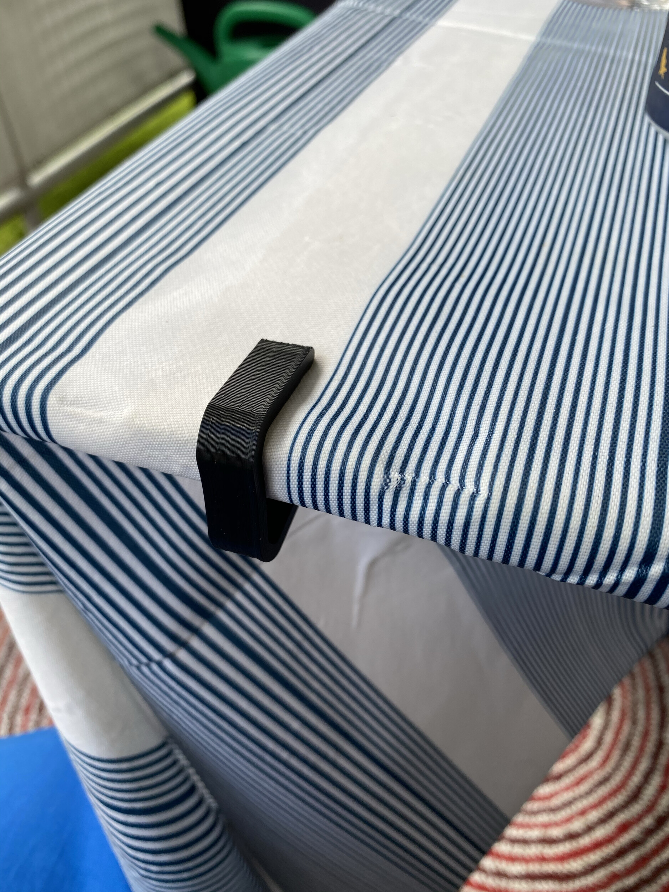
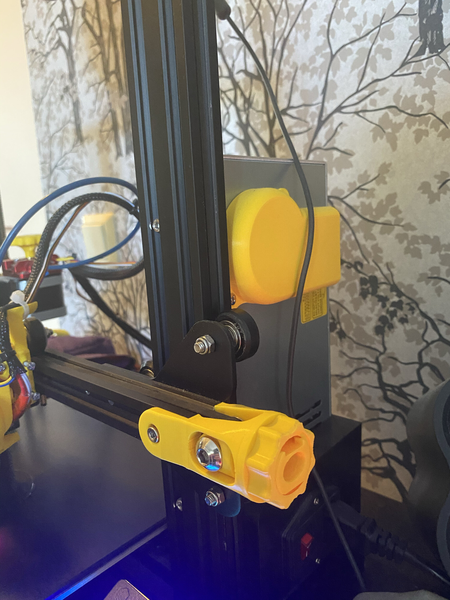
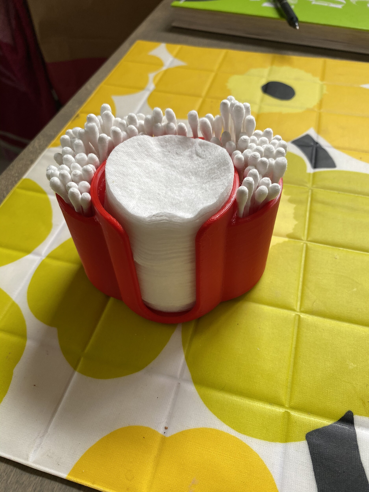

Kirjoittelinkin puolisen vuotta sitten [3D tulostuksen aloittamisesta](/2020/hyppy-3d-tulostamisen-maailmaan) ja nyt on aika kirjoitella siitä lisää. Olen tulostellut jonkin verran ns. funktionaalisia tulosteita eli tavaraa mikä pistetään suoraan hyötykäyttöön ja on joiltain osin hyödyllistä ”muovikamaa”.

Alle listailinkin jokusen hyödyllisen tulosteen mikä on tälläkin hetkellä käytössä. Osasto on kuva jemmassa, mutta osasta taas sitten ei…

.")

Ylläolevien lisäksi on tullut tulosteltua mm.

- S-koukkuja varastoon mm. pyörän renkaiden ripustamiseen
- S-koukkuja vessaan mm. pyyhkeitä varten
- Seinäkoukkuja koiran hihnoja varten
- Pari puhelintelinettä

Eli saa tällä ihan järkevääkin aikaan. Paljon on tulostettavaa vielä ja paljon tulosteita jäänyt mainitsemattakin. Nyt olen hieman opetellut Fusion 360 ohjelmaa, jotta voi itse jo hieman mallintaa noita malleja sekä tulostaa mitä haluaa/tarvitsee.

Olen myös pienimuotoisesti koittanut myydä tulosteita, mutta se ei ole vielä ottanut tuulta allensa. Ensimmäisenä koeeränä ollut sydämen muotoiset paikkamerkit.

Kommentit/ajatukset/ehdotukset/muut ovat tervetulleita aiheeseen liittyen!
