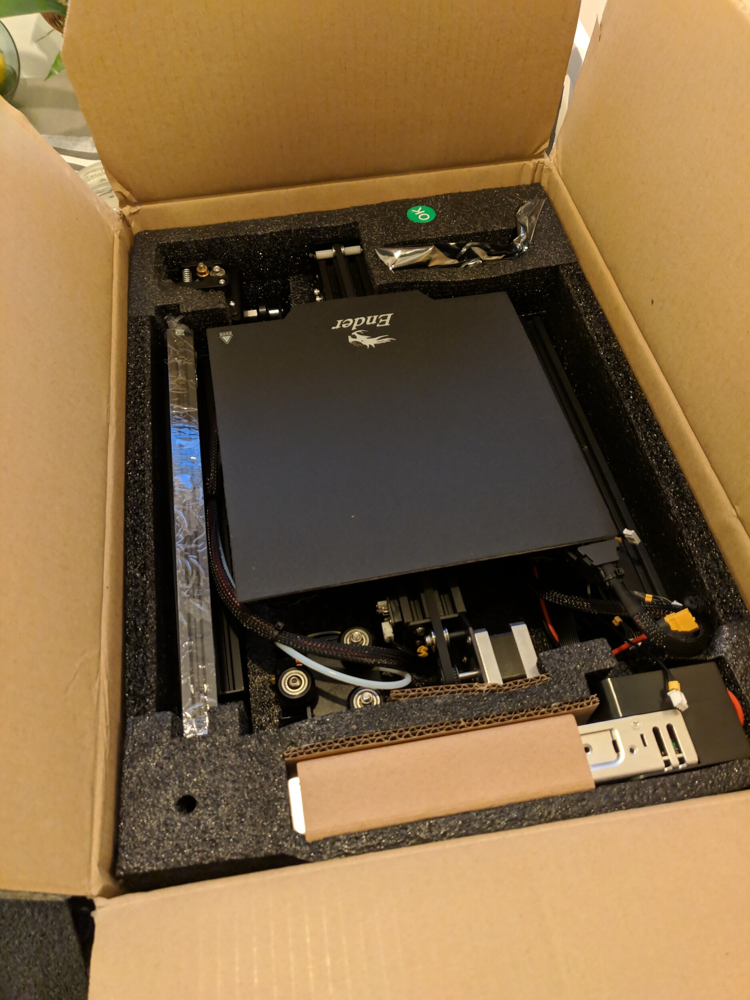
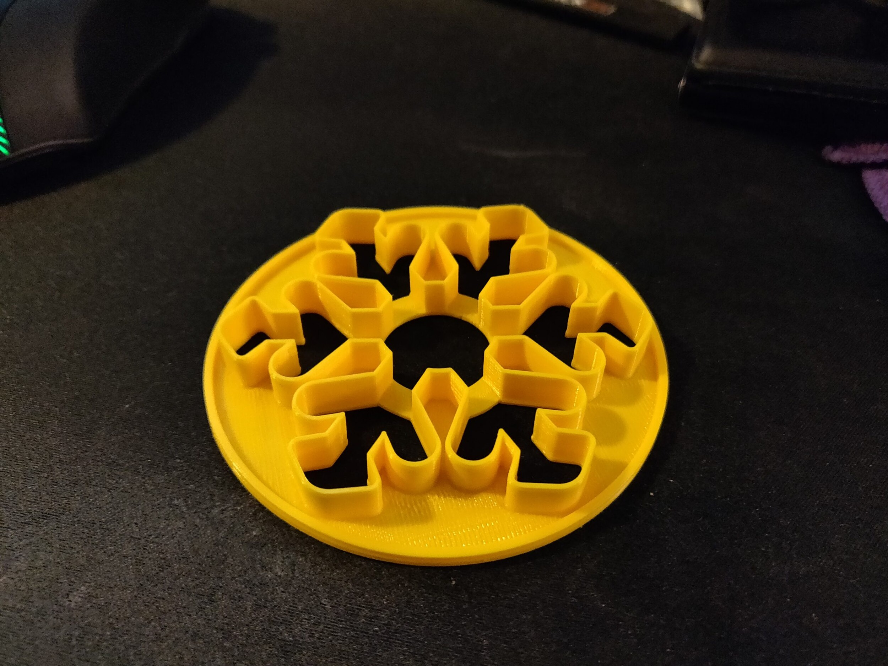
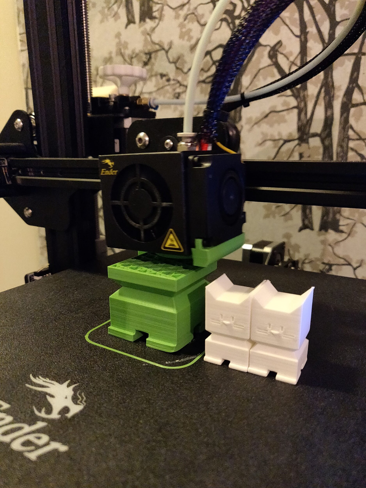
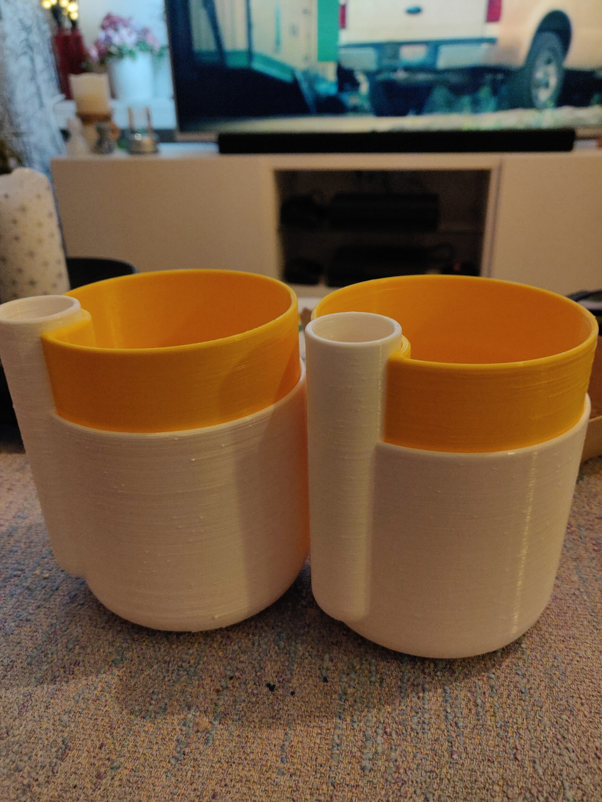
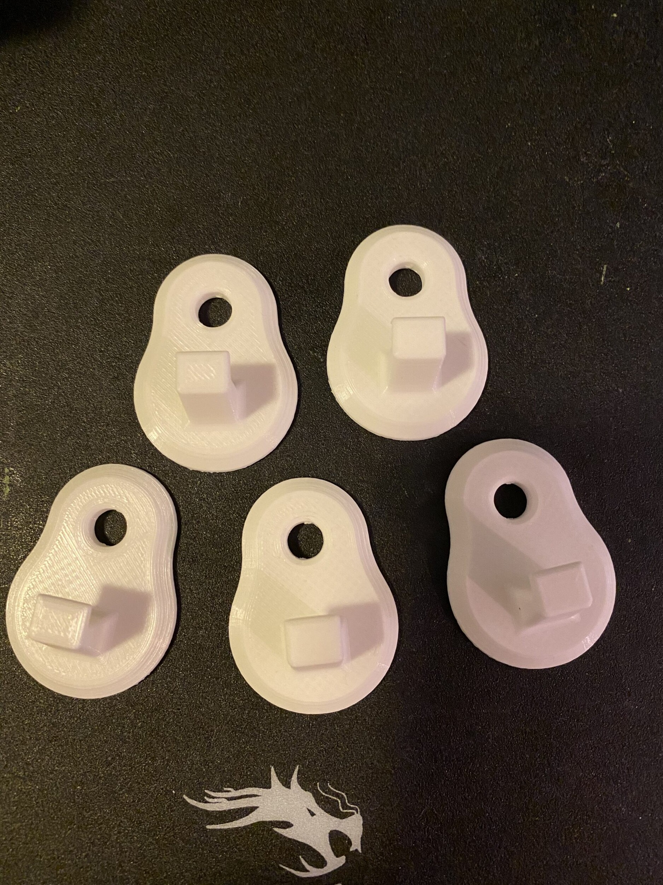
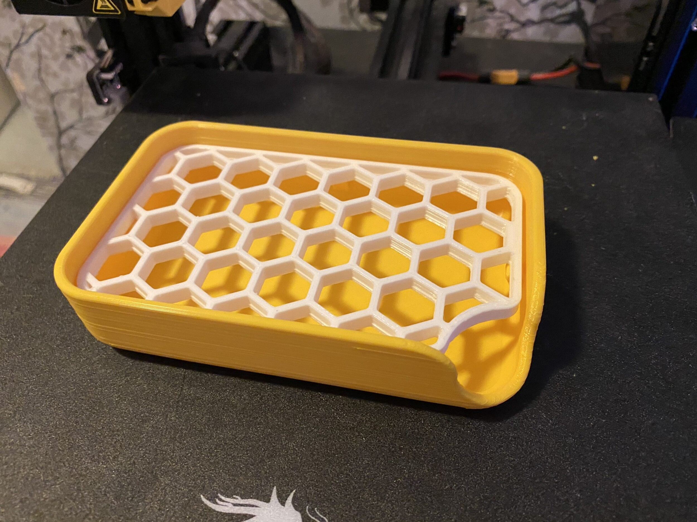
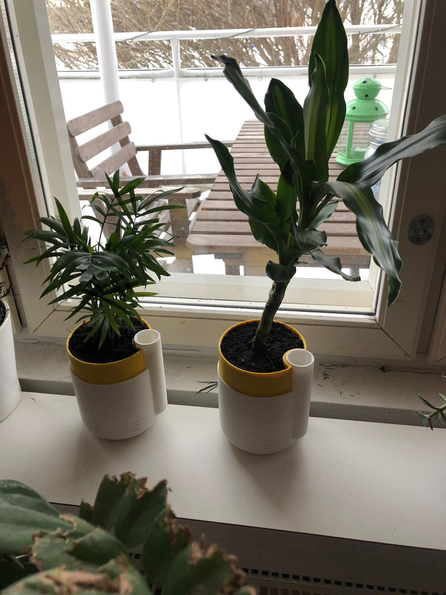
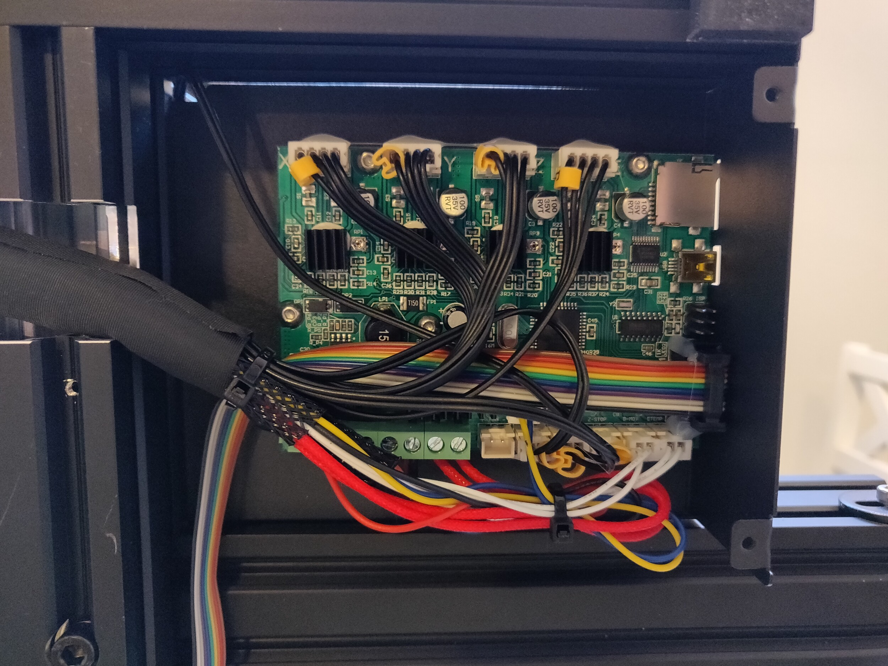
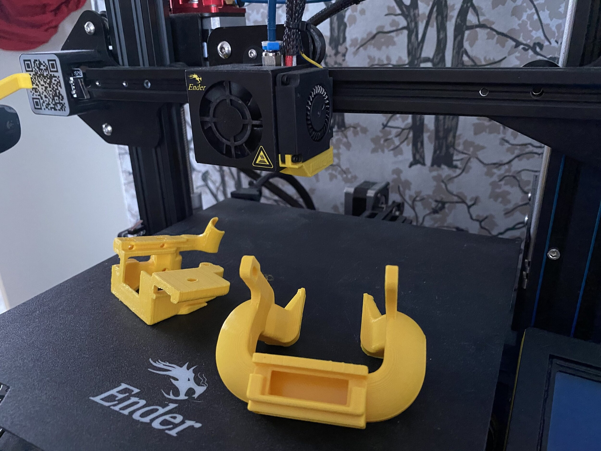
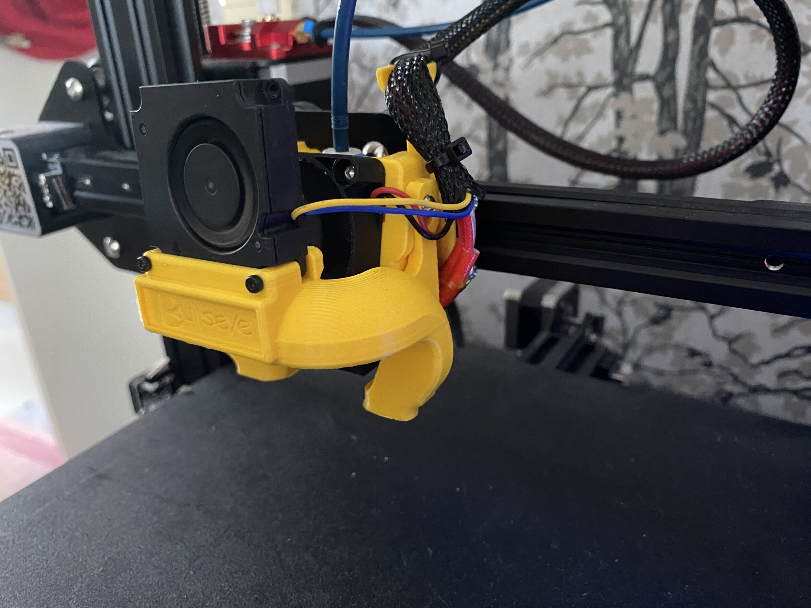

Marraskuussa piipahdin Puolassa ja ennen sitä tulikin postissa 3D-tulostin. En kerennyt ennen reissua pistää sitä kokoon ja reissun jälkeen meni vielä työmatkan takia itsenäisyyspäivän jälkeen ennen, kuin pääsin kasaamaan itse tulostinta.

Tulostin, joka postissa saapui oli Ender 3 Pro ja tämähän on suhteellisen edullinen tulostin ja sen saa kotiin alle 200 eurolla. 3D-tulostamisen aloittaminen ei tänä päivänä ole siis kovinkaan kallis investointi.

3D-tulostimella saadaan käytännössä muovista tulostettua asioita. Voidaan siis 3D-mallista tulostaa esimerkiksi vaikka piparimuotti. Muovi käytännössä pursotetaan kerros kerrokselta tulostusalustalle. Tästä 3D tulostimen tulostusmateriaalista käytetään termiä filament / filamentti.

## Kasaaminen

Tämä oli ehdottomasti se pelottavin vaihe itsellä. Positiivisena asiana tämä tuli osittain valmiiksi kasattuna, joten ei loppujaan ihan kauheasti tarvinnut kasata.

Olin toki valmistautunut ja katsonut parikin YouTube videota aiheesta ja tiesin suunnilleen mitä kasaaminen vaatii ja mitä siinä pitää suunnilleen tehdä.

Kasaus onnistui hyvin vaikka olenkin suht noviisi tämmöisten kanssa. Toki olen tietokoneita kasannut, mutta onhan se eri asia, kuin 3D-tulostimen kasaaminen.

Ohjeet oli välttävät ja suosittelenkin tutkimaan YouTubesta löytyviä kasausvideoita.

## Tulostaminen

Tulostaminenhan ei ole ihan niin yksinkertaista, kuin painat nappia. Ensin pitää tietysti löytää jonkinlainen malli mitä lähdet tulostamaan. Internet on onneksi täynnä ilmaisia malleja tulostettavaksi ja ohjeita löytyy vaikka millä tapaa. Itse olen käyttänyt pääasiassa Thingiverseä mallien etsimiseen.

Mallin löydyttyä pitää se vielä käsitellä ohjelmalla semmoiseen muotoon, jonka 3D tulostin osaa tulostaa. Itse käytän sliceriä nimeltä Cura, joka on ilmainen. Tällä 3D malli muutetaan gcode muotoon, jota tulostin sitten lukee.

Sen jälkeen, kun meillä on gcode niin voidaankin sitten siirtää se muistikortille ja kortti tulostimeen.

Tietenkin tulostimesta pitää laittaa ensin tulostuspeti suoraksi. Eli säädetään pedin korkeutta niin, että se on sopivan etäisyyden päässä suuttimesta. A4 paperia voi käyttää tässä apuna ja sen paksuus onkin suht hyvä väli suuttimen ja pedin kohdalla.

Myös ennen tulostusta pitää olla materiaalia tulostimessa eli filamenttia pitää myös olla ja se syötettynä tulostimelle.

Kun peti on kunnossa ja tulostimelle on syötetty filamenttia voidaankin valita sitten itse tiedosto tulostettavaksi. Tämän valinnan jälkeen tulostimen peti alkaa lämmetä määritettyyn lämpötilaan (noin 60 astetta) ja tulostuspää alkaa lämmetä myöskin (noin 200 astetta).

Kun lämmitys on tehty alkaa itse tulostus ja sen kesto riippuu täysin mallista sekä tulostusasetuksista. Itsellä pisimpiä kestoja on tällä hetkellä alle 10 tuntiset tulostukset.

Mitä sitä on tullut tässä tulosteltua sitten? Tietenkin päivityksiä, joista alla hieman lisää. Tietysti erinäisiä testitulostuksiakin pitää tulostella. Ensimmäiset hyödylliset tulosteet oli piparkakku muotit vaimolle ja ne toimikin ihan hyvin. Toiset mallit paremmin, kuin toiset. Sitten tuli myös tulosteltua altakasteluruukkuja pari kappaletta. Eli saa ihan hyödyllisiä asioitakin tulosteltua.





Hätäisen ihmisen hommaa tämä ei kuitenkaan ole sillä tulostus voi kestää kauan ja jos haluaa nopeammin niin jälkikin on sitten huonompaa.

Yllätyin hieman myös siitä, että tällä hintaluokalla sai aika hyvää jälkeä vaikka en vielä mikään pro tämän käytössä olekaan. Välillä tuleekin ongelmia, joiden parissa menee ilta jos toinenkin selvittäessä ja ne ei välttämättä ratkea silloinkaan.

Tämä on siis sopiva harrastus puuhastelijalle, joka tykkää säätää ja päivittää tulostinta.

## 3D malleista

Kuten mainitsin niin malleja olen vasta napannut Thingiversestä, mutta pari ajatusta on jo siihen, että pitäisi saada tehtyä täysin omiakin malleja.

Pidempään on ollut ajatuksena tehdä ns. kodin tietokeskus eli pieni näyttö, jota pyörittää Raspberry Pi ja se näyttää erinäistä tietoa kuten lämpötilat ja bussiaikataulun. Käytännössä osat on jo olemassa, mutta ei ole sopivaa koteloa tälle.

Jos on vinkata ajatuksia tai ideoita niin ne ovat tervetulleita!

## Päivityksiä

Tietty 3D tulostimeen pitää tulostaa päivityksiä. Sehän se vitsi on, että tulostin 3D tulostimella toisen tulostimen.

Vaikka tulostin on toiminut aika hyvin niin ensimmäisenä kiinnitin huomiota sen tekemään meluun ja varsinkin moottoreiden meluun. Ensimmäisiä isompia päivityksiä olikin hankkia uudempi äly eli ns. Silent Mainboard tuohon tulostimeen ja tässä päädyin kokeilemaan valmistajan omaa boardia. Sen asennus oli taas mielenkiintoinen homma ensikertalaiselle, mutta tulostin toimi sen jälkeen ja hiljeni huomattavasti. Enää pitäisi tuulettimet jossain välissä päivittää hiljaisempiin!

Tulostettavista päivityksistä olen koittanut nyt pariakin eri puhallinta tuohon tulosteen viilennykseen ja nyt onkin käytössä ehkä niistä mielenkiintoisin.





Tuli myös filamentille tulostettua ohjuri, jotta se tulee hieman fiksummin tuolta ylhäältä. Samoin takakansi tuolle LCD näytölle, jotta ei sormet sorki sitä. Hihnojen kiristimetkin tulis myös tulosteltua, jotta niiden säätö on helpompaa.

Pedin jouset tuli myös vaihdettua hieman jämäkempiin ja nyt sitä ei ihan niin useasti tarvitse säätää.

Tulevina päivityksinä on varmaan nuo tuulettimet jossain välissä ja sitten on jo tilattu BLTOUCH, joka auttaa tuon pedin säätämisen kanssa.

## Lopuksi

Tulette varmasti lukemaan jatkossakin blogista tästä tulostimesta ja 3D tulostamisesta yleensä. Välillä on ollut hauskaa ja välillä on suoraan sanottuna v\*tuttanut, kun tulostus on mennyt pieleen loppumetreillä.

Tulostin on hieman yllättänyt sillä hintaluokassa tuo on jo aika hyvää vastinetta rahoille. Itsellä ei tosin ole vertailukohtaa muista tulostimista vaikka kiinnostaisi kyllä lähteä tutkimaan muitakin tulostimia…

Tulosteiden viimeistelyä en ole vielä lähtenyt harrastelemaan sen pahemmin. Kiinnostaisi kyllä hieman kokeilla niiden maalaamisen ja puuhastelun kanssa pidemmällekkin. Niistä saisi kyllä todella hyviä, jos vain lähtisi puuhaamaan hiomisen, pohjustuksen ja maalaamisen kanssa.

Mikäli teillä on muuten kysyttävää tästä tulostimesta tai 3D tulostamisesta muutenkaan niin antaa paukkua!
