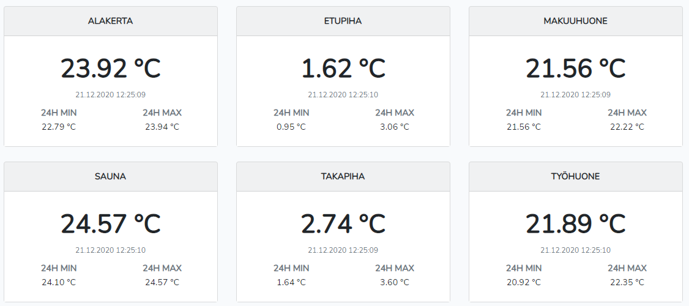
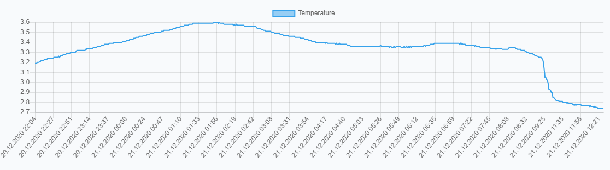
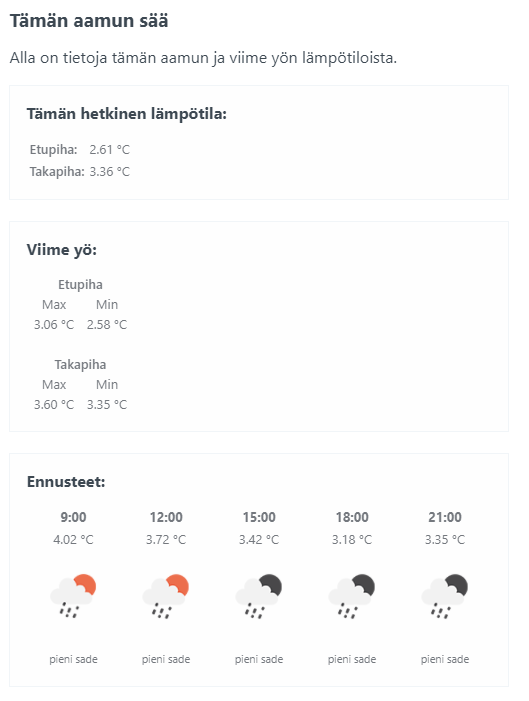
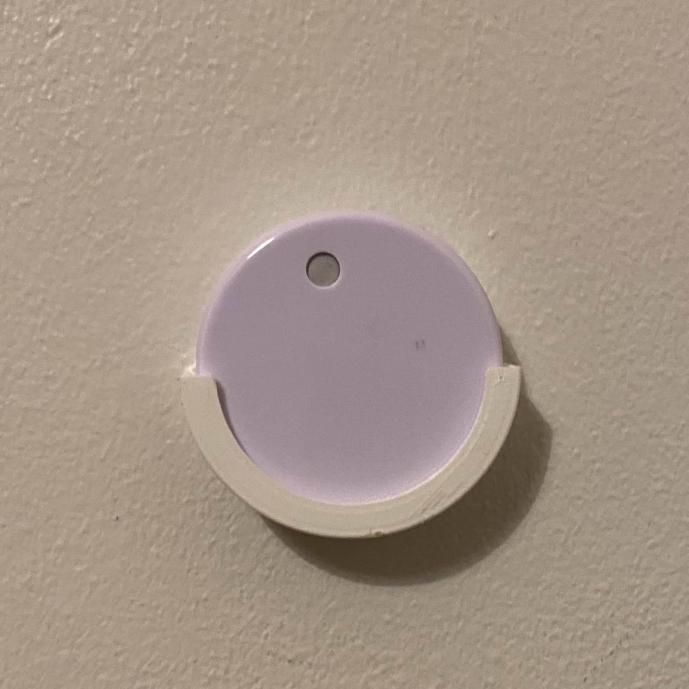
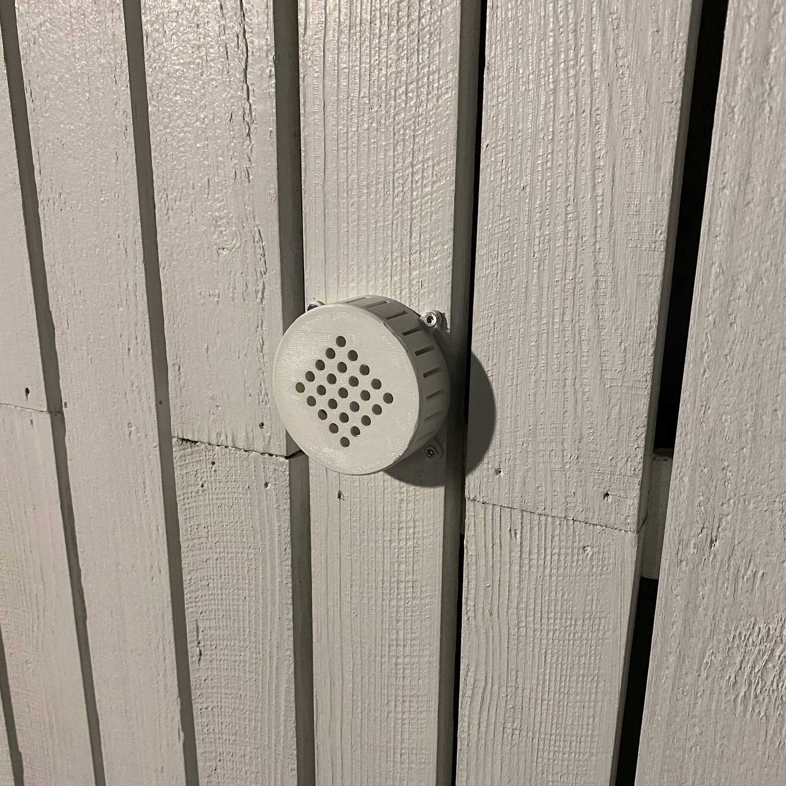

Voisin väittää, että moni meistä on ostanut yhden jos toisenkin sääaseman, jossa on langattomia ja langallisia sensoreita. Itse ainakin olen ostanut useammankin kappaleen. Kaikissa on ollut samaa ongelmaa ja ovat lopulta joutaneet roskiin. Se ulkosensori ei nyt vaan toimi kunnolla ja ei signaali tule edes luotettavasti muutamaa metriä ulkoa sisälle.

En edes muista monennenko halpavehkeen kanssa tuli taas ulkomittauksessa ongelmia, kun aikanaan päätin tilata ensimmäisen 3-packin RuuviTageja. Ajatuksena oli silloin pistää vanha käyttämätön Raspberry Pi tietokone keräämään dataa ja tunkemaan ne omalle palvelimelle ja siellä sitten käpistellä sitä. Näinhän siinä sitten kävikin. Ensimmäiset ruuvit tulikin toukokuussa 2019.

Nykyään, kun olen muuttanut isompaan (2. kerroksiseen) asuntoon on RuuviTageja jo kuusi kappaletta. Myöhemmin tulevissa kuvissa näkyykin missäpäin asuntoa mikäkin sensori on.

Ruuvihan on avoimen lähdekoodin langaton sensori. Sillä voit mitata mm. lämpötilaa, ilmanpainetta ja ilmankosteutta. Itseä noista kiinnostaa pääosin lämpötila. Nämähän ovat muuten suomalaisen Ruuvi Innovations Oy käsialaa ja taustalla häärää mm. Lauri Jämsä joka muuten pyöritti Ruuvipenkki.fi sivustoa aikoinaan.

## Niin mitä tehdään?

Säädetään. Ekat kolme Ruuvia tuli siis toukokuussa 2019 ja nehän piti pistää toimintaan. Itse Ruuvit sai toimintaan helposti. Otti vain pariston välistä muoviliuskan pois ja itse RuuviTag oli sillä toimintavalmis.

Dataakin voit alkaa heti tutkimaan sillä ilmaisella Ruuvi Station puhelin applikaatiolla näet heti mitä tietoa RuuviTag lähettää, kunhan vain lisäät sen ensin. Tämä riittää jo monelle sillä näin saat reaaliaikaisen tiedon lämpötilasta suoraan RuuviTageista. Eli ei sinun tarvitse säätää yhtään tämän enempää. Itse Ruuvi Station sovelluksella pärjää jo tosi pitkälle ja itsekin käytän sitä.

Sitten säätämiseen. Koska RuuviTag ei ollut ihan uusi juttu tuolloin 2019 niin oli jo aika paljon oppaita ja apuja olemassa. Itsellä oli tosiaan Raspberry Pi kaapissa ja pistin sen toimivaksi taas. Oma Raspberry Pi on vain sisäverkossa ja siihen ei pääse ulkoverkosta käsin ollenkaan.

Siihen löysinkin sitten Python kirjaston, jolla saadaan luettua RuuviTagien dataa. Tämä kirjasto on vieläkin käytössä ja löytyy Githubista: <https://github.com/ttu/ruuvitag-sensor>

Itsellä pyörii joka minuutti cronissa hieman modifioitu koodinpätkä. Taisi olla se osittain 2019 esimerkkinä tuossa repossa. Alla on vielä tuo koodinpätkä niille jotka kaipailee vastaavaa.

    from urllib.parse import quote
    import requests
    from ruuvitag_sensor.ruuvi import RuuviTagSensor

    macs = [
        'XX:XX:XX:XX:XX:XX',
        'XX:XX:XX:XX:XX:XX',
        'XX:XX:XX:XX:XX:XX'
    ]

    timeout_in_sec = 5

    url = 'https://server.test/endpoint'

    datas = RuuviTagSensor.get_data_for_sensors(macs, timeout_in_sec)

    for key, value in datas.items():
        requests.post(url + quote(key), json=value)

Tuo koodinpätkä lähettää tietoa minun palvelimelleni, jossa pyörii Laravelin päällä sovellus. Sovellus vastaanottaa tuon python skriptin datan ja tallentaa sen tietokantaan. Minulla siis tallentuu joka minuutti tieto jokaisesta RuuviTagista ja näitä sitten voin hyödyntää miten haluan.

Tällä hetkellä käytössä on yksinkertainen näkymä siitä mitä mikäkin sensori näyttää ja 24h ajalta maksimi sekä minimi. Jokaisen sensorin takaa saan vielä yksittäiset tulokset halutessani sekä hieman käppyrää.

Itsellä tulee myös joka aamu kuudelta tieto sen hetkisestä lämpötilasta, sekä mitä yöllä on ollut ja vielä ennuste (OpenWeatherMap apia käyttäen) sen päivän säästä.

Tuo koodipuoli on vielä itsellä kehityksessä ja siihen olisi halu saada hälytykset esim. Telegrammin kautta. Ajatus olisi siis, että saisi saunan lämpiämisestä hälytyksen. Eli voisin pistää vaikka niin, että kun seuraavan kerran saunassa olevan RuuviTagin lämpötila on 60 astetta saan ilmoituksen siitä.

Sensorien lisääminen on suhteellisen helppo homma. Lisään vain MAC osoitteen Python koodiin ja sitten nimeän sen MAC osoitteen tuolla omassa softassani ja Ruuvi Station applikaatiossa.

## Miten homma on toiminut?

Lyhyesti: hiivatin hyvin. RuuviTagit ovat toimineet hyvin ja niiden kanssa ei ole ollut ongelmia. Raspberry Pi:stä on hajonnut yksi virtalähde ja sen takia on jäänyt dataa tulematta. Samaten ollut hieman ongelmia, kun päivittänyt Raspberry Pi:n sovelluksia ja sitten on tuo koodi lakannut toimimasta. Eli tämmöistä pientä säätöä.

Näiden RuuviTagien signaalikin on ihan älyttömän hyvä. Mulla on tässä asunnossa Raspberry Pi alakerran vaatehuoneessa. Yläkerran kaikki RuuviTagit lukee hyvin ja ehkä pahin on saunan sensori, joka on yläkerrassa kauimmaisessa nurkassa ja se toimii moitteetta. Samoin tuo Ruuvi Station sovellus lukee kaikki sensorit olit missä päin asuntoa.

Itse webbipuoli on toiminut tosi hyvin ja sinne on mennyt data kuten pitääkin. Ainut, että on vielä hieman raskasta koodia ja sinne pitäisi tehdä optimointeja johtuen tuosta isosta massasta mitä tuota dataa tulee (1440 riviä / sensori / päivä).

Siitä huomaa helposti, kun homma lopettaa toimimisen on ettei tuota aamuista sähköpostia ole tullut. Silloin pitää yleensä alkaa perkaamaan, että missä on ongelmaa. Yleensä ongelma on ollut tuossa Raspberry Pi päässä.

3D tulostin on ollut myös pirun hyvä homma tän kannalta. Olen nimittäin tulostellut tuolle kiinnikkeet joilla se on kiinni saunassa ja ulkona. Ulos suunnittelin ja tulostin vielä erillisen suojakotelon, joka tulee siis tuon Thingiversestä napatun kotelon päälle. Suunnitteilla on tuohon ulkokoteloon versio missä on RuuviTagin pidike itsessään.





Sensorit ovat myös kestäneet tosi hyvin. Saunassa oleva sensori on vielä käyttökunnossa ja täysin toimintakuntoinen. Samoin sensori, joka on ollut ulkona käytännössä koko ajan. Muut sensorit ovatkin pääsääntöisesti sisätiloissa ja ns. normaalilämmöissä.

Saunassa oleva teline on hieman lämmössä ottanut muotoa, mutta on vielä täysin käyttökelpoinen. Nämä yksinkertaiset telineet ovat löytyneet Thingiversestä ([JKin](https://www.thingiverse.com/thing:3983256) nimimerkin tekemiä)

## Mitä pitäisi kehittää?

Sensorien asettelu on mielenkiintoinen. Tällä hetkellä takapihan sensori on huonossa kohtaa, koska se näyttää ehkä liian lämmintä ja varsinkin jos vertaa etu- ja takapihan sensoreita. Takapihan sensori on lähempänä taloa ja paikassa mikä on ehkä luonnostaan jo lämpimämpi.

Sovelluksen koodipuoleen pitäisi tosiaan panostaa. Tästä jo hieman mainitsin. Latausajat on joissain kohtaa aika pitkiä, kun en ole optimoinut mitenkään koodinpätkiä. Samoin osa ominaisuuksista on turhia tällä hetkellä, mutta ehkä tulevaisuudessa voisi historiadataa hyödyntää fiksummin.

Samoin tuo hälytysominaisuus olisi kova. Nyt on jo hieno asia se, että näkee saunan lämpötilan nousematta sohvalta. Tämä on kuitenkin toteuttavissa oleva asia taas.

Ulos oleville sensoreille voisi melkein tulostaa vielä lipan, jonka voisi laittaa yläpuolelle. Tämä voisi estää ylimääräisen veden menoa tuohon koteloon.

Raspberry Pi puolella taas pitäisi tehdä parannusta tuon datan lähetykseen. Pitäisi melkein tehdä datapaketti lokaalisti jota koitetaan lähettää ja jos ei jostain syystä onnistu niin yritetään sitten myöhemmin uudelleen. Näin katkokset verkkoyhteydessä tai muut häiriöt ei niin paljoa haittaa. Ainoastaan jos koko Raspberry Pi on pois käytöstä niin sitten ei mene dataa. Toinen vaihtoehto on tehdä toisinpäin eli mun sovellus koittaa hakea dataa Raspin päästä, mutta silloin pitäisi avata se ulkoverkkoon, jota en haluaisi.

## Lopuksi

Pitää ehkä jotain loppuhuomioita vielä pistää. Ensinnäkin tästä artikkelista ei ole maksettu tai annettu sensoreita. Saa toki pistää postiin pari lisää…

Tällä hetkellä on aika yksinkertainen tämä sovellutus. Otetaan data talteen ja ihmetellään lämpötiloja. Tätähän voi aina laajentaa uusilla sensoreilla ja uusilla ominaisuuksilla.

Tämä on tällä hetkellä ainut ns. IoT komponentti tässä talossa ja ollaan vielä nätisti sisäverkossa, joten ulkoverkon möröt ei pääse käsiksi. Yhden Raspberry Pi koneenhan voisi melkein hankkia VPN:ksi, jotta pääsisi ylipäätään tänne sisäverkkoon… Tässäpä ajatusta tulevaan.

**Ideat ja vinkit on muuten tervetulleita!**
