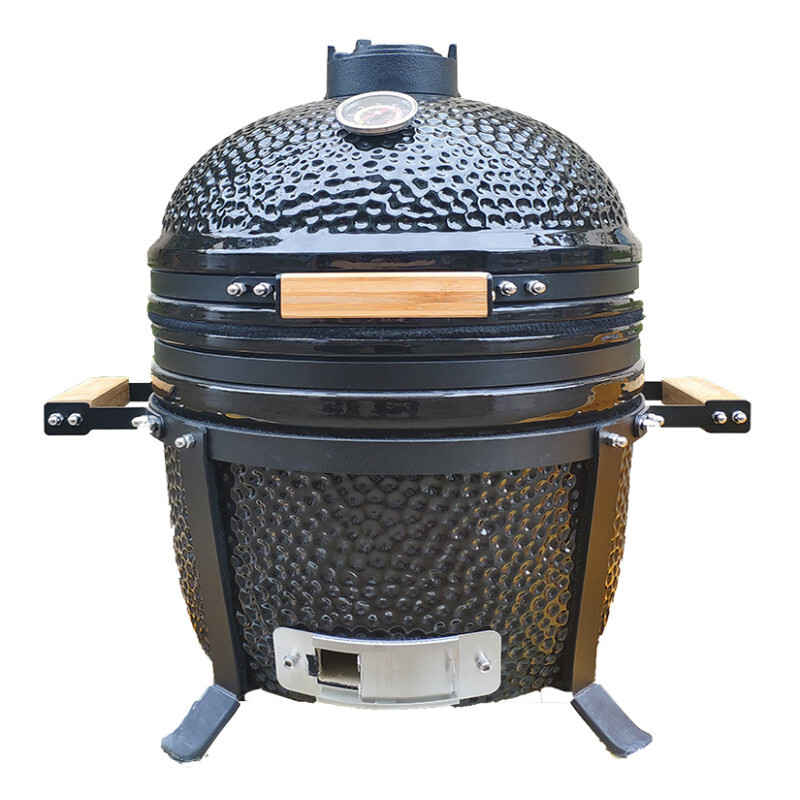

Niin ostitko muka kamadon jo? En.\
Onko se jotain Japania tai Kiinaa? Ei.

Kirjoittelinkin [pallogrillailusta](/2021/pallogrillailua) tuossa joku aika sitten. Nyt olenkin hieman tutkinut erilaisia kamadoja ja nämähän vaikuttaa mielenkiintoisilta peleiltä.

Tämä tarkempi tutustuminen alkoi itseasiassa siitä, kun törmäsin [Tokmannin](https://www.tokmanni.fi/keraaminen-kamado-grilli-bbq-king-15-6419860545790) sivuilla tarjoukseen pienestä kamadosta. Harmikseni tätä ei Kuopiosta saati Tokmannin verkkokaupasta enää löytynyt. Samaa hintaluokkaa olisi ollut myös [Motonetissä](https://www.motonet.fi/fi/tuote/8500969/Roastmaster-G-series-keraaminen-grilli-15), mutta tämänkin saatavuus olematon.

Kysehän olisi nimenomaan ns. halpiskamadosta. Mikäli oikein olen käsittänyt ja tutkinut niin nämä on suht samaa kamaa ja tulee Kiinasta Auplexin tehtaalta.

Niin mikäs se kamado oikein onkaan. Suurimmalle osalle tunnetuin kamadotyylinen grilli on ehkä Big Green Egg. Tästä ja kamadon muodosta johtuen tämä myös tunnetaan ns. munagrillinä. Kamadon periaatteena on keraaminen kuori ja se, että se pitää lämpöä ihan eri tavalla, kuin esimerkiksi hankkimani Weber pallogrilli.

Miksi sitten ns. halpiskamado? No yksinkertaisesti hinnan vuoksi. Tommoisia pieniähän saisi myös Big Green Eggiltä MiniMax noin 1000€ hintaan, Kamado Joelta Jr malli reiluun 500€ hintaan sekä muutakin tuossa 400-600 hintaluokassa. Tommoinen alle 200€ sijoitus ei olisi paha kokeilu tuommoiseen – en ainakaan itse koe.

Nythän on sinällään hyvä vuodenaika tämmöisille hankinnoille sillä aika paljon grillikamaa on nyt tarjouksessa. Onkin tullut hankittua terassin suojamattoa, pihtejä sekä lastoja hyvinkin edullisesti vs. normihinnat. Hiiliä/brikettejä kyttäilen myös ja ajatuksena on hankkia tavaraa, jotta kestää talven yli ja varmaan ensi vuoteenkin.

Takaisin kamadoon. Jos olisi rahaa millä mällätä niin varmaan lähtisin Kamado Joen tarjontaa tutkailemaan. Sillä on nimittäin laadukkaita kamadoja sekä taitaa tuo hintakin olla hitusen mukavampi, kuin Big Green Eggin plus se on punainen… Toinen vaihtoehto voisi olla Bono joka on sitten halvempaa kuin Kamado Joe.

Niin mitäs tuolla pienellä ”munalla” olisi tarkoitus sitten grillailla. No, ajatuksena olisi käyttää tuota ns. apugrillinä sekä pienempiä määriä grillailla siinä. Sekä voisi hyvin pistää esim. kasslerin sinne pidemmäksi aikaa ja sitten pallogrillillä tehdä muut roippeet. Nyt vähän tuppaa olemaan, jos pallogrillissä on pidempi veto niin toki voit muutakin pistää siihen ja tulikin mainiot kermapotut tehtyä ribsien kaveriksi, mutta et oikein voi hitaalla ja matalalla sekä kovalla lämmöllä yhtäaikaa tehdä. Vaatii siis suunnittelua ja muutenkin välistä grillattavan määrä on suht kova ja pitää säätää.

Taisin mainitakin aiemmassa artikkelissa, että yleensä kaasugrilli meni talveksi suojaan, mutta nyt olisi ajatus muuntaa harrastus ympärivuotiseksi. Tämä auttaisi hieman siinäkin tavoitteessa, sillä pienempi koko mahdollistaa tämän pidon pöydällä.

Tämän hetkinen pääasiallinen grillaussettinihän sisältää sähkösavustimen, muurikan ja pallogrillin (ei sis. pizzahommia!). Aika hyvä setti jo tähän mennessä. Tämä kesä onkin pallogrilliin vaihdon myötä ollut hieno grillauskesä ja tullut tehtyä ja tutustuttua uuteen harrastukseen ihan uudella tapaa.

Heitä oma kommenttisi kamadoista ja onko sulla pieni muna! (hehehe)
