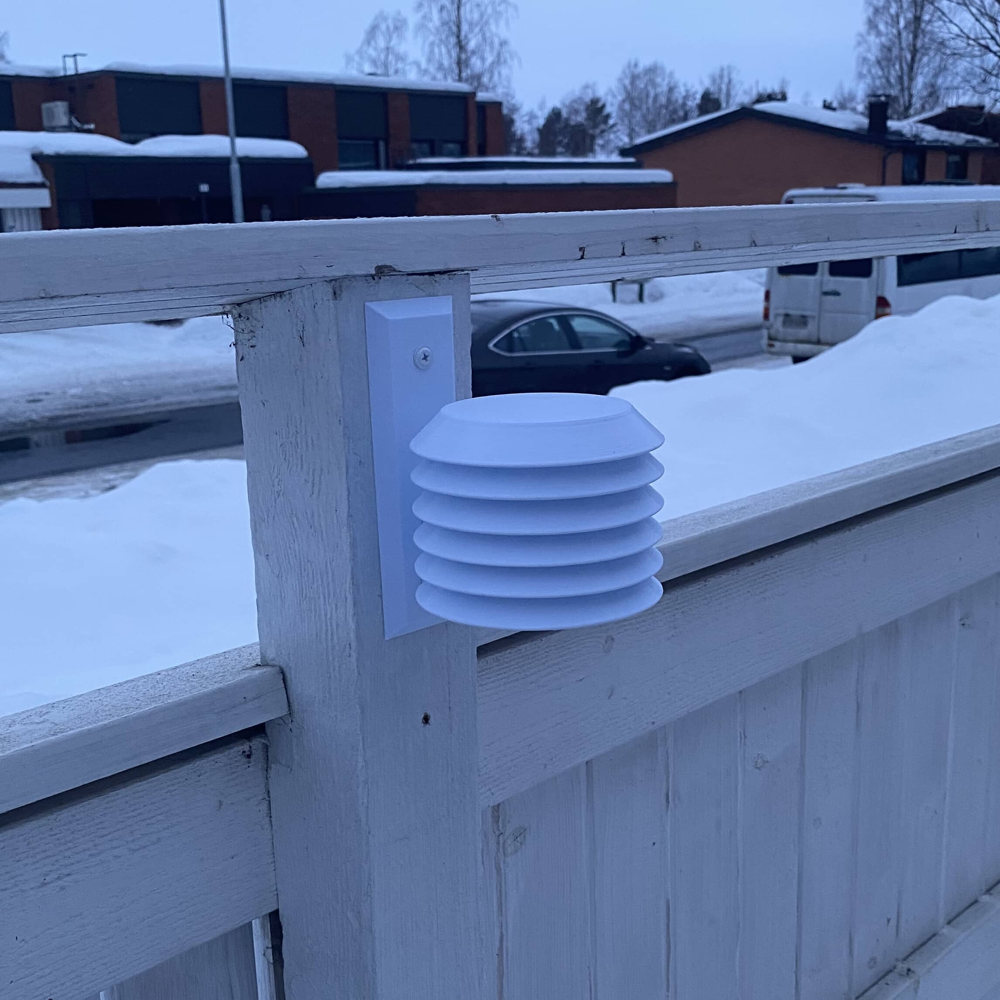
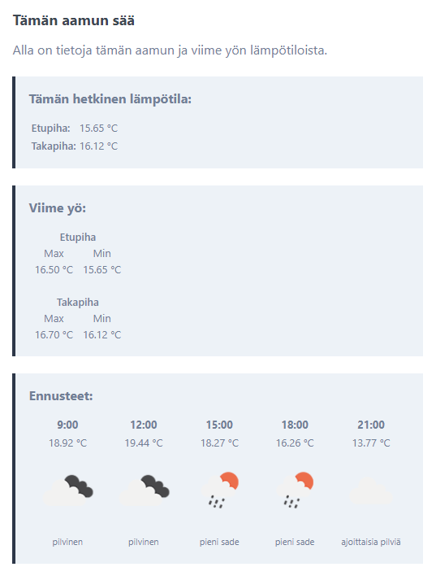
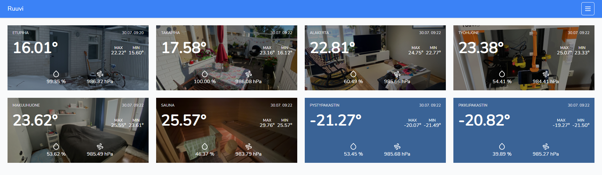
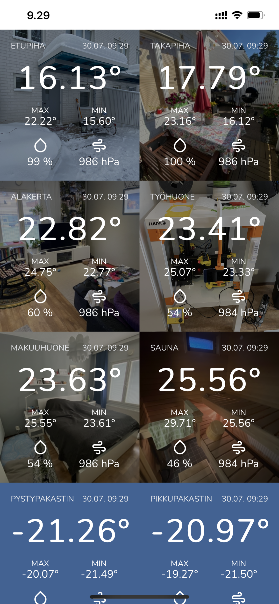

Kirjoittelin tuossa joulun aikaan miten olen ottanut RuuviTag ([ruuvi.com](https://ruuvi.com/)) sensorit käyttöön omassa kodissa. [Linkki artikkeliin →](/2020/ruuvitagit-koko-kodin-lamposensoreina)

Nyt onkin aika päivittää tätä tarinaa. Sensoreita onkin tällä hetkellä kahdeksan kappaletta ja välillä tuntuu, että pitäisi olla pari vielä lisää… Eli nälkähän tässäkin kasvaa syödessä.

Itsessään toiminta ei ole muuttunut. Vieläkin hommaa pyörittää Raspberry Pi tietokoneessa pyörivä Python skripti, joka lähettää joka minuutti sensorien tiedot virtuaalipalvelimelle, jossa sitten tietoa näytetään. Olen vieläkin yllättynyt siitä, että alakerran komerossa oleva Raspberry Pi saa tiedot kaikista RuuviTageista eli niiden kantama on kyllä omaan makuun tosi hyvä.

Hieman olen ulkokiinnityksiä päivittänyt ja varsinkin takapihan osalta. Veli löysi passelin 3D tulostus mallin, joka on nimenomaan RuuviTageille tarkoitettu. Tämän tulostinkin PET muovista ja se on vielä kestänyt tosi hyvin ja toimiikin mallikkaasti.

Aamulla tulee vieläkin tuttu sähköposti, joka kertoo viime yön maksimin ja minimin sekä sen hetkisen tilanteen. Antaapa se sääennusteenkin. Tähän on ulkoasua muutettu sekä hallinan puolelta voi nyt määrittää mitä RuuviTageja näytetään sähköpostissa ja monelta se lähtee.

Hallintaa onkin muutettu sitten oikein urakalla ja ulkoasu onkin muuttunut. Etusivulle on ensinnäkin mahdollista pistää kuvat taustaksi sensoreista jolloin ne tunnistaa helposti. Itseltä uupuu pari kuvaa, kun pakastimien seuranta aloitettiin vasta äskettäin.

Hallintaan on myös tullut mahdollisuus laittaa hälytyksiä. Hälytyksen voikin määrittää haluamakseen eli onko saatu arvo isompi/pienempi kuin haluttu. Voit pistää hälytyksen niin lämpötilaan, ilmanpaineeseen, kosteuteen tai pariston jännitteeseen. Itsellä on käytössä hälytys, kun saunan lämpötila on haluttu sekä jos pakkasten lämpötila menee liian lämpimäksi. Hälytys tulee sitten Telegrammiin halutun viestin kera.

Optimointiakin on tehty tuonne hallinnan puolelle. Joka yö arkistoidaan vanhaa dataa ja näin saadaan tuo varsinainen datatulu pysymään fiksun kokoisena. Arkistoon pitäisikin rakennella työkalu, jotta voi historiadataa seurata ja tutkia.

Myös puhelinkäyttöä on mietitty. iPhonessa saa laitettua verkkosivun kuvakkeeksi ja näin avattua sen kuten minkä tahansa applikaation. Teinkin yksityiset linkit (jotka voi nollata), jotka saa laitettua avautumaan. Samoin käyttöliittymässä on pelkästään sääkortit.

Tätähän voisi tosiaan kehittää vaikka kuinka pitkälle. Nyt ollaan menty tosiaan tällä setupilla ja oon kyllä tosi tyytyväinen. Ei ole puhettakaan, että lähtisin hankkimaan mitään muuta järjestelmään lämpötilan seurantaan. RuuviTagit on helppoja, kun voit vain laittaa sen esim. pakkaseen tai jääkaappiin ja alkaa seuraamaan.

Tämä on myös käytössä veljellä ja hänellä on omat RuuviTagit seurannassa ja omat tunnukset tuohon järjestelmään. Hänellä on myös Raspberry Pi, joka lähettää tuolle palvelimelle kerran minuutissa tiedot.

Home Assistantin kanssa voisi joskus alkaa myös pelailemaan enemmän ja näin voisi saada automaatiota ja älykkyyttä kotiin. Tästä tulenee postausta, jos tälle tielle lähdetään.
