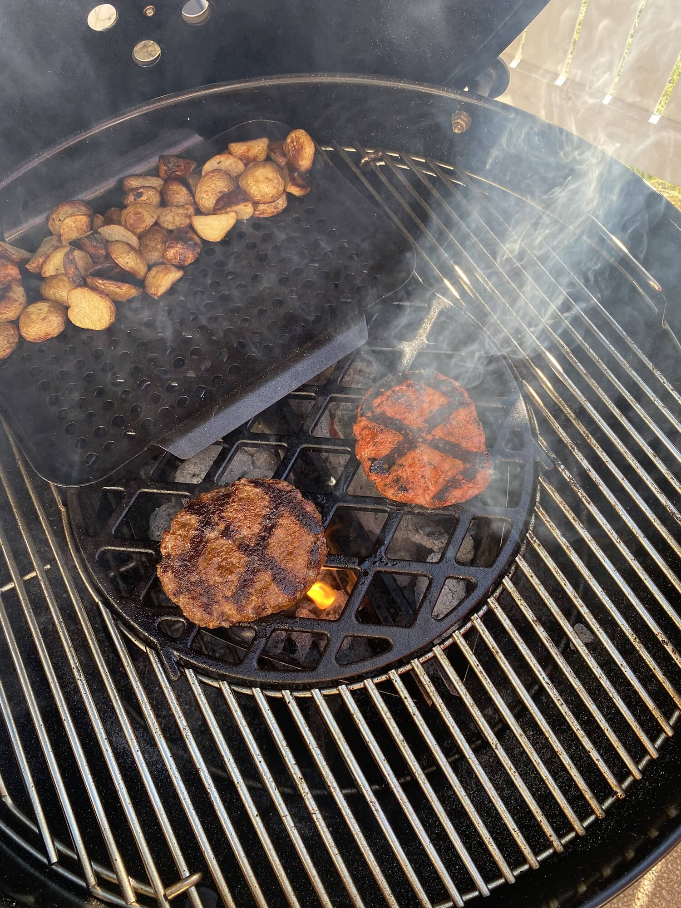
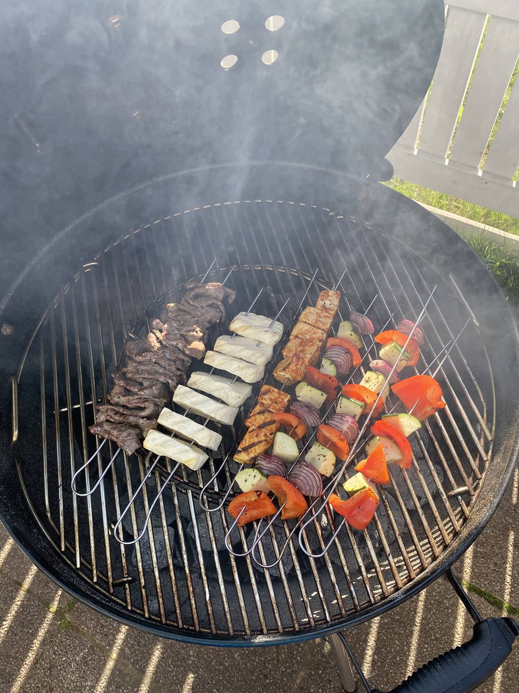
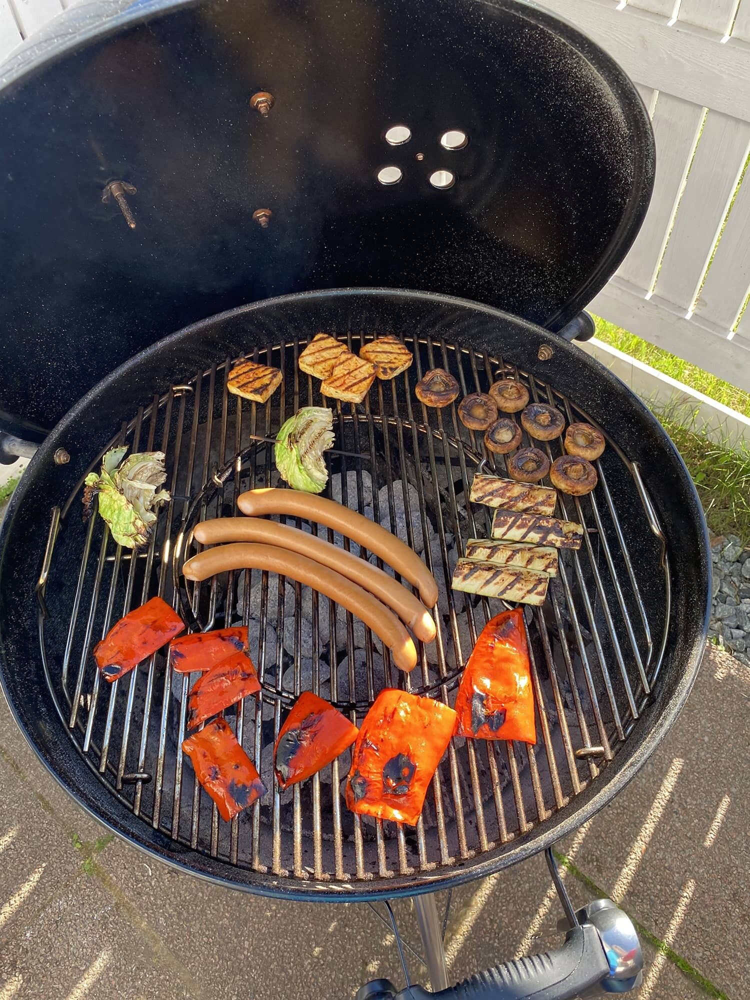
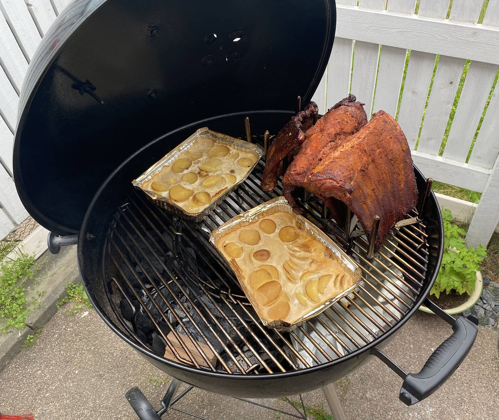

[Muutettiin](/2020/muuttaminen-on-mukavaa-vai-onko) tuossa viime vuoden lopulla ja tänä kesänä taas alkoi herätä ajatus hiilella/briketeillä grillaamisesta, kun siihen tuli mahdollisuus uuden asunnon myötä. Kaasugrillihän minulla on ollut jo aiemminkin pidemmän aikaa ja kesällä grilli käykin kuumana harva se päivä. Laitettiin siis kaasugrilli myyntiin ja uutta grilliä hankkimaan.

Kamadohan se olisi ollut perhanan mukava laitos ja se tuleekin joskus hankittua, mutta siinä tuli oikeastaan hinta jo vastaan. Tuli tehtyä tutkimusta asiasta ja hieman kyseltyäkin tästä asiasta ja lopputuloksena oli, että lähden hankkimaan ensimmäistä Weberiä. Motonetissä oli sitten tarjouksen poikaista ja sai Weberin pallon ostaessa piippusytyttimen kaupan päälle ja pitihän se siihen tarjoukseen tarttua. Mukaan lähti siis Master-Touch GBS E-5750 grilli.

Miksi muuten Weber ja nimenomaan tämä irtonaisella kannella oleva malli eikä mikä tahansa marketin ”halpispallo”. Yksi syy on takuu. Alla onkin listaus Weberin sivuilta, kun rekisteröin grillin sinne. Aika kiva homma, eikös?

- Alaosa ja kansi (10 Vuotta), Kattaa läpiruostumisen tai -palamisen – 05-2031
- One-Touch-puhdistusjärjestelmä (5 Vuotta), Kattaa läpiruostumisen tai -palamisen – 05-2026
- Muoviosat (5 Vuotta), Ei koske haalistumista tai värimuutoksia – 05-2026
- Kaikki muut osat (2 Vuotta) – 05-2023

Toinen on se, että näitähän perhana myydään käytettynäkin ja se vaihtaa omistajaa varsin mukavasti. Kolmantena on varaosien ja lisävarusteiden saatavuus. Nämä molemmat asiat merkkaa takuun lisäksi mulle jonkin verran, kun tehdään ostopäätöksiä mm. grilleissä. Aiempi oli Landmannin grilli ja siinäkin ostohetkellä oli samoja kriteerejä.

Grillin lisäksi Motonetistä lähti samaan pakettiin valurauta ritilä sekä tietty se piippusytytinsetti jossa oli hieman brikettejäkin, jotta päästään alkuun.

Tämähän on minulle ensimmäinen hiili-/brikettigrilli eli päästään harjoittelemaan ja harrastamaan oikein kunnolla nyt. Tällähän saadaan tehtyä vaikka mitä ja vaikka miten. Paljon on tullut katsottua YouTubesta vinkkejä ja kerättyä Facebookissa inspiraatiota grillausryhmissä.

## Mitäs sitten on grillailtu?

No vaikka sun mitä. Eikös ollutkin sopivan savolainen vastaus. Tietenkin perus makkaraa ja hampurilaisia on tullut tehtyä. On myös tehty vartaita ja savustettu ribsejä pidemmän kaavan mukaan sekä myös pottujakin on savuissa näkynyt. Alla onkin jokunen kuva grillailuista.





## Mitäs sitten puuhaillaan?

Paljon on vielä ns. kokeilulistalla. Wingsejä pitäisi tehdä Ikea Vortexin avulla (kannattaa tutustua Vortex menetelmään). Sitten pulled pork, pihvit, Poppamiehen [ohjeella](https://www.poppamies.fi/kanagyros-tsatsikilla/) kanagyrosta sekä monta muuta juttua on mielessä.

Nälkä on kasvanut syödessä ja olenkin hitusen tutkaillut matkagrillejäkin… Weber Go Anywhere on mielenkiintoinen setti ja samaten Weber Smokey Joe. Noista ehkä tällä hetkellä tuo WGA olisi parempi omaan käyttöön. Olisihan tuo kiva lisä pallon rinnalle…

Vinkkejä ja ehdotuksia saa muuten heitellä kommenttiboksiin!

## Tyytyväinen?

Kyllä. Tämä on ollut tämän kesän parhaita hankintoja ja grillaaminen on nyt piirun verran mukavempaa puuhastelua. Erilaisten juttujen kokeilu on ollut mukavaa hommaa ja ajatus olisi, että grillaus olisi ympärivuotista touhua jatkossa. Kaasugrilli meni nimittäin talvikaudeksi pois käytöstä itsellä, mutta nyt voisi harrastaa koko talvenkin.
