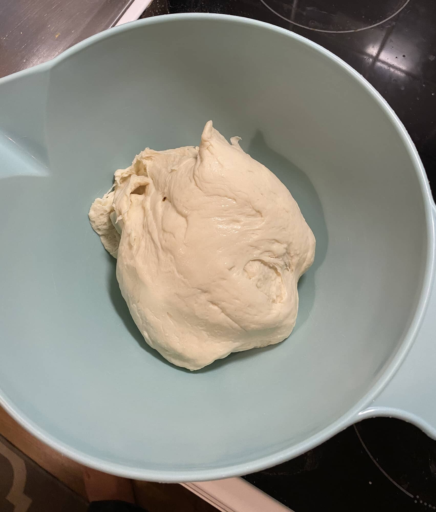
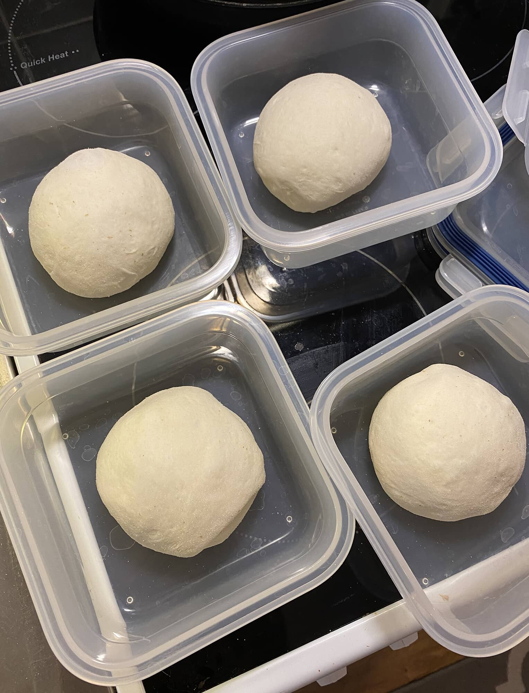
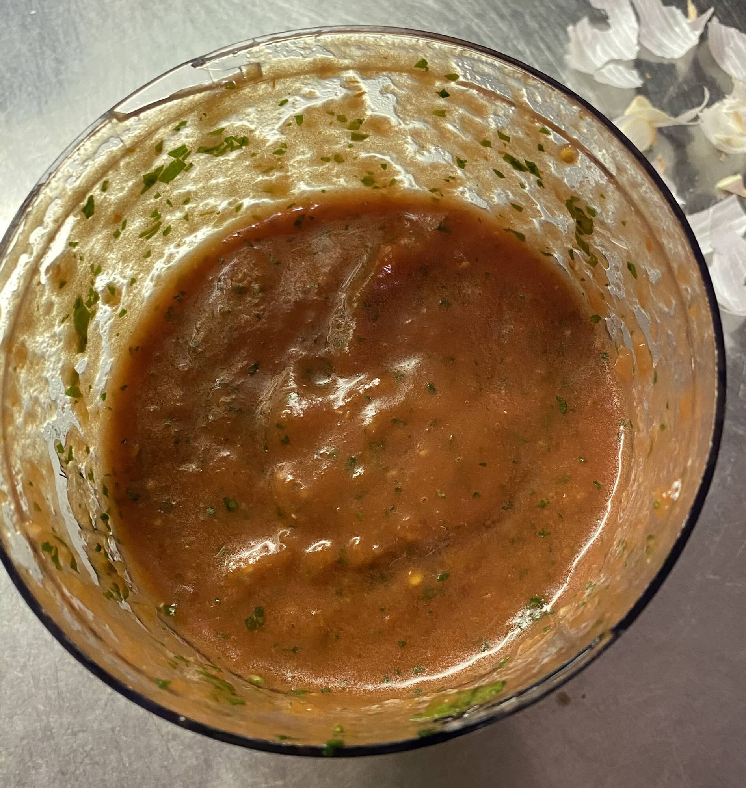
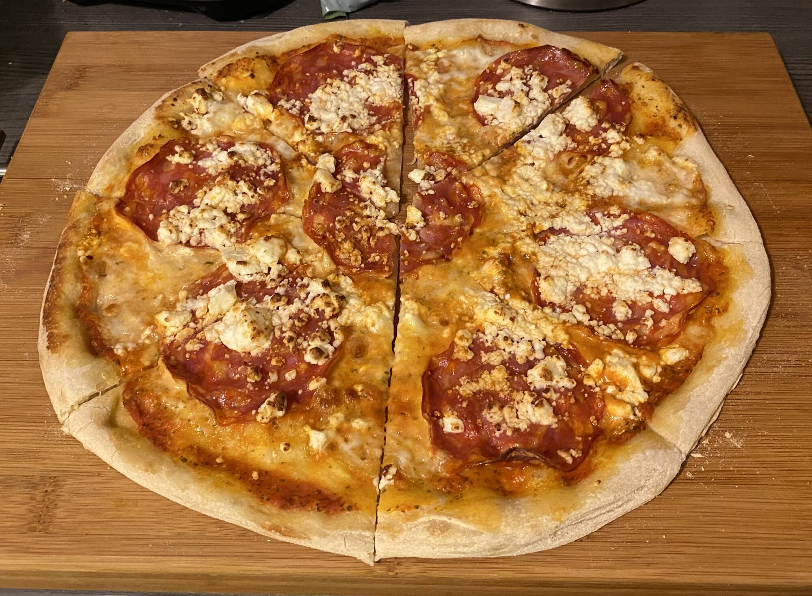
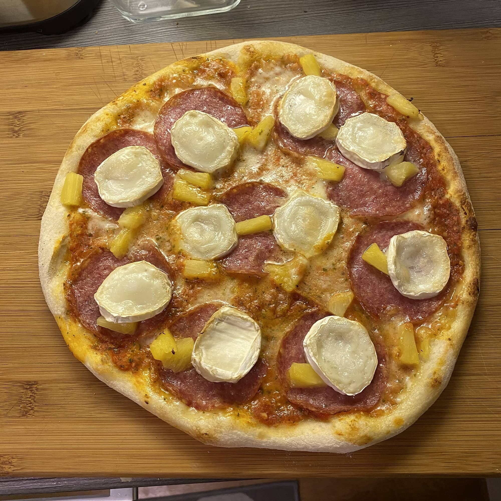

Tämmöistä artikkelia, ette varmaan odottaneet, mutta tämän kirjoitan osaksi itselleni muistiin ja osaksi jakoon muillekin. Ollaan nimittäin tehty jokusen kuukauden ajan pizzaa ja saatu oman maun mukaan sopiva taikina ja soosi.

Ensinnäkin kiitokset sinne minne ne kuuluu. Tähän ohjeeseen on saatu iso inspiraatio Pizze kirjasta ([Otava](https://otava.fi/kirjat/pizze/)) ja itse käytän vielä määrien säätämiseen Oonin applikaatiota ([Ooni](https://eu.ooni.com/)).

Tarvitset ainakin keittiövaa’an sillä nyt puhutaan grammoista. Itsellä on hankintalistalla vielä hieman tarkempi vaaka, mutta hyvin pärjätään tavallisella keittiövaa’alla, jolla saadaan täysinä grammoina luku.

Tämähän on muuten kolmen päivän projekti. Eli jos meinaat syödä [pizzaa](https://uutisankka.com/viihdeuutiset/janne-kataja-treffeilla-blondiseurassa-pitsaa-ja-jaavetta-tampereella/) lauantaina tämän ohjeen mukaan niin työt alkaa torstaina. Jaankin siis hommat per päivä. Homman nimi on sitten kylmäkohotus ja taikina viettääkin aikaa jääkaapissa 48 tuntia. Soosi taas 24 tuntia.

## Päivä 1 – Pohja

Aloitetaan pohjasta tai ainakin pohjan ensimmäisestä vaiheesta. Homma alkaa mittaamalla kaikki pohjan ainekset valmiiksi. Oikeasti, mittaa nämä ensin ja ala sitten hommiin.

Jauhoina olen käyttänyt 00-jauhoja ja suosittelenkin Caputo Pizzeria 00-jauhoja, joita saa ainakin K-Citymarketista ja itse olen käyttänyt nimenomaan sitä sinisessä pussissa olevaa Caputo Pizzeria jauhoa.

Alla on ainekset neljään pizzaan ja kuuteen pizzaan.

**Ainekset 4 pizzaa:**

- 518 grammaa 00-jauhoja
- 326 grammaa vettä
- 16 grammaa suolaa
- 10 grammaa oliiviöljyä
- 2.2 grammaa kuivahiivaa

**Ainekset 6 pizzaa:**

- 776 grammaa 00-jauhoja
- 489 grammaa vettä
- 23 grammaa suolaa
- 16 grammaa oliiviöljyä
- 3.3 grammaa kuivahiivaa

Kun olet mitannut aineet ota 30 (tai 50 jos 6 pizzaa teet) grammaa vettä erilleen ja sekoita suola siihen. Kaikki suola ei imeydy siihen, mutta ei se haittaa.

Laita kaikki jauhot, kuivahiiva ja loppu vesi astiaan ja ala vaivaamaan. Itse käytän yleiskonetta ja se hoitaa hommat. Ensimmäinen vaivaus kestää noin 10 minuuttia.

Sitten laita suolavesi sekaan ja vaivaa lisää kunnes suolavesi imeytynyt taikinaan.

Tämän jälkeen vielä öljy sekaan ja vaivataan taas kunnes öljy on imeytynyt taikinaan.

Sitten vaivataan hieman tehokkaammin vielä hetki.

Tämän jälkeen taikina onkin valmis jääkaappin. Laita taikina kulhoon ja peitä kunnolla kelmulla. Taikina tulee nousemaan reilusti, joten varaa sopiva kulho.

Tässä olikin kaikki ensimmäisen päivän työt.

## Päivä 2 – Pohjan ”palloittelu” ja tomaattikastike

Toisena päivänä työstetäänkin tomaattikastike ja tehdään pohja palloiksi.

### Pallojen teko

Ota taikina noin 24h jääkaapissa asustelun jälkeen pois. Nyt kaiva taas vaaka esille. Jauhoa työtaso (kannattaa käyttää hieman karkeampaa jauhoa) ja ota taikina pois kulhosta. Taikinasta tehdään ensin neljä noin 215-220 grammaista palaa.

Sen jälkeen sen voi itse työstä käsissä palloiksi. Jokaisella on hieman omaa tyyliä ja ei se ihan niin justiinsa tartte olle. Tässä hieman Oonin antamaa vinkkiä aiheeseen:



Kun taikina on palloina niin itse olen pistänyt ne pakasterasioihin ja takaisin jääkaappiin. Tässäkin vaiheessa pallot kohoavat vielä!

### Tomaattikastike

Tehdäänpä vielä samaan syyssyyn tomaattikastike. Tämä on aika pitkälti suoraan Pizze kirjasta, mutta valkosipuli on jätetty soosiin.

**Ainekset:**

- 1 tölkki kuorittuja tomaatteja
- 10 grammaa suolaa
- 10 grammaa oliiviöljyä
- Tuoretta basilikaa
- 2-3 valkosipulinkynttä.

Itse käytän tähän Lidlistä joskus otettua silppuria jolla olen todennut, että saa oikein mainion koostumuksen. San Marzanot olisi tähän varmaan parhaita purkkitomaatteja, mutta tuppaa olemaan aina loppu kaupasta…

Laita astiaan ensin tomaatit ja riko ne ja lisää suola, oliiviöljy sekä pilkotut valkosipulinkynnet. Lopuksi sekoita basilika mukaan.

Itse pilkon ensin valkosipulit ja heitän sitten kaikki mukaan Lidlin silppuriin ja soosi tulee, kuin itsestään.

Laita astia jääkaappin odottamaan seuraavaa päivää.

## Päivä 3 – Pizza time!

Vihdoin on se aika. Paistetaan pizzaa. Ota kuitenkin pari tuntia ennen paistoa pizza pallot pois jääkaapista huoneenlämpöön. Voit muuten huoletta paistaa yhtenä päivänä 2 pizzaa ja jättää toiset kaksi palloa vielä seuraavalle päivälle.

Itse pidän yksinkertaisista pizzoista ja täytteenä onkin yleensä tomaattikastike, mozzarella ja salami. Lisänä ollut joskus paprikaa, fetaa, vuohenjuustoa ja milloin mitäkin. Oman maun mukaan!

Tomaattikastikkeesta riittää yleensä 6 pizzaan tai riippuu miten laitat. Soosi käy myös kivasti lämpimiin voileipiin.

Itse asiaan. Pistä uuni täysille, siis täysille. 300 astetta ei ole liioittelua. Jos paistat kivellä niin lämmitä kiveä reilusti.

Uusin kokeilu oli myös Housen pizza-alusta, jolla tuli muuten myös erinomainen pizza! Kannattaa kokeilla ja hintakin on edullinen. Löytyy [Prismasta](https://www.prisma.fi/fi/prisma/house-pinnoitettu-pizza-alusta-35cm).

Kun uuni on lämmin niin tee pallosta pizza. Tähänkin on ohjetta netin puolella ja alla onkin taas Oonin videota.



Täytä tämän jälkeen pizza. Oma järjestys: tomaattikastike, puoli palloa mozzarellaa silputtuna, salami ja murustettu feta (uusin kokeilu ja toimi tosi hyvin). Sitten pizza uuniin!

Mikäli käytät kiveä niin suosittelen pizzalapiota! Sillä saa pizzan kivelle tosi näppärästi ja itse olen asetellut pizzan muotoilun jälkeen lapiolle ja täyttänyt siinä ja siitä sitten uuniin.

Uunissa pizza viihtyy 6-8 minuuttia. Ainakin omassa uunissa 300 asteessa. Kannattaa tutkailla ja ottaa pois, kun siltä tuntuu.

Alla on pari eri pizzaa mitä on viime aikoina tullut uunista ulos. Kommentit, vinkit ja omat pizzat ovat tervetulleita!





*Artikkeli ei ole sponsoroitu vaikka sisältääkin kasan linkkejä eri paikkoihin.*
