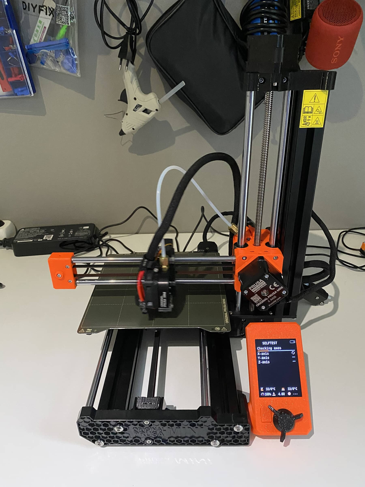
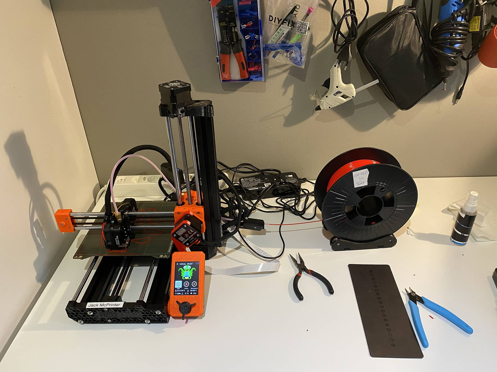

Otetaas alkukatsaus miten on matka Prusa Mini+ kanssa lähtenyt liikenteeseen. Tuli tosiaan pistettyä [Ender 3 Pro](/2020/hyppy-3d-tulostamisen-maailmaan) ”lihoiksi” ja sen tilalle tulikin sitten Prusa Mini+.

Sain Minin tuossa tiistaina ja silloin pistettiin kone kasaan ja alettiin tulostelemaan.

Olen kuullut Prusasta paljon ja varmaan moni muukin on kuullut Prusasta paljon. Minihän on heidän uusimpia tulostimiaan 32 bittisellä emolevyllään. Minin isoveli MK3S+ on taas hieman isompi malli ja varmaan heidän yksi myydyimpiään tulostimiaa ylipäätään (veikkaus).

Niin miksi Mini sitten Enderin tilalle? Mulla alkoi olla Enderiin aika paljon projektia ja hieman vähemmän aikaa mitä olisin halunnut käyttää siihen. Mini myös houkutteli koon puolesta ja suurin osa tulosteista mahtuu Minin 18\*18\*18cm pedille. Kristallipallo, kun olisi ollut niin tilanne olisi toinen – tästä lisää myöhemmin blogissa…

Tietysti Prusalla on maine siitä, että heidän kama on laadukkaampaa, kuin ”kiinan tavara”. Tämä on jo siinä huomioitavana, että he ei joka vuosi tunge uutta mallia pihalle ja joskus jopa saman mallin sisällä on eri emolevyä sisällä (köh Enderit).

En tähän ala tarkempia speksejä tuosta Ministä listaamaan vaan ne löydätte tuolta Prusan omilta sivuilta: <https://shop.prusa3d.com/en/3d-printers/994-original-prusa-mini.html>

## Kasaus

Otin mallin mikä tulee käytännössä kolmessa osassa. Eli kasaaminen on suht helppo prosessi ja ohjeita seuraamalla onnistuu suht helposti. Mukana tulee tosiaan ohjekirja, jossa on kasausohjeet ja niitä noudattamalla koneen saakin kasaan. Itse katsoin pari kuvaa isompana verkosta löytyvästä ohjeesta. Ohjeista on mainittava se, että mukana tulee nallekarkkeja ja kannattaa noudattaa ohjeiden mukaista nallekarkkien syömistä! Älä siis syö kaikkea kerralla vaan kuten ohjeistettu!

Aloittelijalle tämä olisi suht helppo kasaus, mutta pari hieman venkulaa kohtaa tuossa oli, kun yksin sitä kasasi. Apuri voi olla siis hyödyllinen jos tätä aloittelijana kasaa. Kasaukseen tarvitset vain hieman englannin ymmärrystä. Verkkosivujen ohjeet on ehkä paremmat, kuin tulostetut juuri sen takia, että voi katsoa kuvat isompana. Kaikki työkalut mitä kasaamiseen tarvitaan tulee mukana.

## Aloittaminen

Ensimmäisen käynnistyksen yhteydessä saat ”aloitusvelhon” eteesi, jossa tulostin tekee testaukset itselleen, jotta näkee toimiiko kaikki. Tässä myös tehdään ekan kerroksen kalibrointi, joten ota mukana tullut pieni määrä filamenttia valmiiksi tai sitten oma filamentti valmiiksi.

Itse ajelin tuota ensimmäisen kerroksen kalibrointia jokusen kerran, jotta olin tyytyväinen siihen miten filamentti tarttui kiinni. Tämähän kantsii tehdä, kun esim. vaihtaa suutinta tai tulostusalustaa.

Tässähän ei tarvitse petiä ns. laittaa suoraan vaan automatiikka hoitaa hommaa jos siinä on pientä eriäväisyyttä. Pääset siis suoraan tulostamaan mikäli näin haluat. Pistinkin itse ekana printtinä tulemaan sammakon mikä löytyi USB-tikulta. Sehän onnistui kerrasta hyvin.

Alussa oli tietty pientä ongelmaa, josta kerron hieman lisää alla. Muuten ollaan kuitenkin aika positiivisessa fiiliksessä sillä ottaen huomioon ongelmat ja ekan printin laadun niin ollaan tosi pitkällä.

## Ongelmat

Kerron hieman ongelmia mitä on tässä parin päivän aikana tullut vastaan.

### XZ-axis vinossa

Tämä ongelma oli oikeastaan alusta asti ja ihmetytti jo asennuksessa. Pedin luotaus (bed probing) nimittäin loppui asennusvelhossa joka kerta etu vasempaan reunaan ja se ei ollut tehnyt sitä loppuun, josta syystä ensimmäisen kerroksen kalibrointi ei onnistunut kunnolla.

Sitten, kun saman kalibroinnin ajoi valikosta niin luotaus meni loppuun ja homma rokkasi. Samoin jos tulostit USB-tikulta niin homma rokkasi ja luotaus meni maaliin.

Ongelman alkoi huomata, kun Octoprinttiä viritin sillä olen sen verta laiska etten ala USB-tikkua vekslaamaan vaan haluan verkon yli pistää tulostuksen käyntiin ja monitoroida tulostusta. Octoprint on mulla lähiverkossa ja ulkoverkosta ei suoraan tähän pääse – näin se pitääkin olla. [OctoEverywhere](https://octoeverywhere.com/) kuitenkin auttaa etämonitorointiin.

Aina, kun laitoin tulostuksen menemään Octoprintistä se epäonnistui virheeseen Probing failed koodilla M112. Kohtana oli nimenomaan tuo etu vasen kulma. Sama gcode tulostui kuitenkin USB tikulta ongelmitta.

Epäilin ensin ongelmaa Octoprintin ja Prusa Minin välillä, mutta tähän en ratkaisua löytänyt. Sitten törmäsin toisen tulostimen kanssa olleeseen ongelmaan, jossa luotaus loppui, koska firmwaressa ollut pedin epätasaisuuden maksimiarvo ylittyi. Mittasin työntömitalla eron etu oikean ja etu vasemman kulman välillä ja sitä oli yli 2 milliä.

Sitten googleen ja löysinkin ohjeen Prusan sivuilta. Ohjehan oli hyvä ja sillä se sitten ratkesikin. Kahden millin ero katosi ja ajoin asennusvelhon uusiksi sekä ensimmäisen kerroksen kalibroinnin ja homma rokkasi.

Näin jälkikäteen olisin voinut kysyä Prusan tuesta tätä heidän chatin kautta. Olisin voinut saada sieltä suoraan vastauksen, mutta näin tuli taas itse opittua hieman. Pääasia, että ongelma ratkesi.

Ohje mikä auttoi: <https://help.prusa3d.com/en/article/xz-axis-skew-correction-mini_158518>

### Extruder tukossa

Toinen ongelma tuli vastaan, kun eilen aamulla aloitin tulostusta ja mitään ei tullut läpi. No tätä sitten tutkimaan ja syyksi selvisi, että extruder ei puske filamenttia läpi.

Tästäkin löytyy Prusalta ohje miten purat extruderin ja puhdistat sen. Eihän tuo olisi mutullakaan vaikea purkaa, mutta arvostan kyllä hyviä kuvallisia ohjeita.

Ohje mikä auttoi: <https://help.prusa3d.com/en/guide/how-to-access-and-clean-the-extruder-pulley-mini-mini_126457>

## Loppusanoja

Tähän mennessä ei muita ongelmia olekaan tullut vastaan ja tulosteet on ollut kyllä priimaa. Ensimmäinen kerros on hyvä ja varmaan parempi vähemmällä säädöllä mitä Enderissä on ollut. Silläkin tosin sain hyvää jälkeä aikaan ja olin pirun tyytyväinen siihen sillä se opetti todella paljon.

Enderin kanssa en kauheasti PETG:tä tulostellut, mutta tällä olen pistänyt sitäkin menemään. PLA ja PET on ne pääasialliset materiaalit mitä tulostelen ja nyt pitäisikin pistää pidempää projektia työn alle sillä pitäähän tulostimeen tehdä modeja! Työn alle lähtee [Prusa Mini Base](https://www.prusaprinters.org/prints/63483-prusa-mini-base) joka tekee tuosta hieman korkeamman paketin, mutta myös omalta osaltaan kompaktimman.

Mulla on myös ajatus tehdä ihan myyntiin asti tulosteita ja tähän onkin tulossa tulevaisuudessa hieman apuja muutenkin. Ideoita on ja niitä otetaan tietty aina vastaan.

Voin kyllä suositella näin parin päivän jälkeen Prusa Mini+ tulostinta. Kooltaan hyvin kompakti, mutta silti tosi kykeneväinen laitos. Olisi mielenkiintoinen joskus hankkia Minin isoveli (MK3S+) tulostin ja kasata se ihan alusta asti – he kun myyvät sitä osina, jolloin se on hieman halvempikin. Mininkin olisi saanut osina, mutta sen toimitusaika oli pidempi, kuin tämän osittain kasatun.

Nyt jatkuu kuitenkin tulostelut ja puuhastelu tulostimen kanssa. **Mitä haluaisitte tietää aiheesta?**
