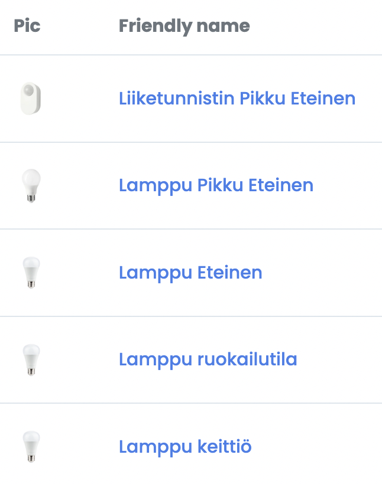

Olenkin kirjoitellut jo aikaa sitten tästä [älykoti](/sarja/alykoti) projektista ja nyt se alkaa olla tekemistä vaille valmis.

Tarkoitan siis, että kaikki alkaa olla testattu ja pitäisi siis vain saada HomeAssistant konfiguroitua ja otettua kunnolla käyttöön. Puhutaan kuitenkin ensin hieman miten päädyin asentamaan sen.

Olin aiemmin asennellut HomeAssistanttia kokeeksi Raspberry Pi:lle SSD kanssa ja ilman. Nyt kuitenkin käsiin jäi vanha työkone, josta sitten aloin rakentamaan kodin palvelinta. Koneeseen Ubuntu ja sitten Dockerin avulla kontteihin erilaisia palveluita. Tästä tulee vielä lisää juttua, mutta keskitytään nyt HomeAssistanttiin.

Valitsin Dockerin ja tarkemmin Docker Composen sillä ne olivat mulle tuttuja jo jollain tapaa entuudestaan. Hommahan toimii niin, että koneelle laitetaan Docker ja Docker Compose ja sitten tiedostolla konffitaan Docker container ja käynnistetään se. Helppoa?

En ala tarkemmin Dockerin ja Docker Composen asennusta ja käyttöä alkaa käymään läpi sillä siihen on Internetissä ohjeita vaikka kuinka.

## HomeAssistantin määreet

Mulla on /opt kansioon mapattu yksi kiintolevy ja sinne tulen laittamaan Dockerin kontit ja palvelut. Sinne olen kansioinut jokaisen palvelun omaksi kansiokseen ja omaksi docker-compose.yml tiedostoksi.

Alla onkin alkuun mun HomeAssistantin docker-compose.yml tiedosto.

    version: "3"
    services:
      homeassistant:
        container_name: homeassistant
        image: "ghcr.io/home-assistant/home-assistant:stable"
        volumes:
          - /opt/homeassistant/config:/config
          - /etc/localtime:/etc/localtime:ro
        restart: unless-stopped
        privileged: true
        network_mode: host
        devices:
          - /dev/ttyUSB0:/dev/ttyUSB0

Tässä on oikeastaan suhteellisen simppeli määritys. Kerrotaan, että /opt/homeassistant/config viittaa /config kansioon ja sinne tuleekin sitten HomeAssistantin asetusmääreet ja voit niitä muokata suoraan siinä. Samoin kerrotaan tuo minun Zigbee tikun olemassaolosta, jotta HomeAssistant osaa sitäkin sitten käyttää.

Tämän avulla saankin HomeAssistantin pyörimään tuolle koneelle ja sitä voi alkaa konffia. Sainkin helposti Ruuvit ja muut toimimaan ja päästiin testaamaan.

## Zigbee tikku toimimaan

Mainitsinkin tuossa, että Zigbee tikusta kerrottiin HomeAssistantille. Päädyin ottamaan käyttöön Zigbee2MQTT sillan, jolla saan sitten Zigbee laitteita lisättyä ja sen kautta sitten saadaan ne HomeAssistanttiinkin.

Tämäkin menee Dockerin kautta ja alla onkin tämän palvelun docker-compose.yml.

    version: "3"
    services:
      mqtt:
        image: eclipse-mosquitto:2.0
        restart: unless-stopped
        volumes:
          - "/opt/zigbee2mqtt/mosquitto-data:/mosquitto"
        ports:
          - "1883:1883"
          - "9001:9001"
        command: "mosquitto -c /mosquitto-no-auth.conf"
      zigbee2mqtt:
        container_name: zigbee2mqtt
        restart: unless-stopped
        image: koenkk/zigbee2mqtt
        volumes:
          - /opt/zigbee2mqtt/zigbee2mqtt-data:/app/data
          - /run/udev:/run/udev:ro
        ports:
          - 8080:8080
        environment:
          - TZ=Europe/Helsinki
        devices:
          - /dev/ttyUSB0:/dev/ttyUSB0

Tämäkin on suht helppo, mutta esitellään kaksi palvelua: zigbee2mqtt ja mosquitto. Nämä on myös /opt alla ja kerrotaan taas polut palveluilla missä on mitäkin.

Tämän jälkeen taas palvelua pyörimään ja homma rokkaamaan. Kokeeksi olenkin sinne jo jokusen lampun liittänyt ja tavoite on laitella loputkin sinne. Nämähän tulee sitten suoraan näkyviin HomeAssistanttiin ja voi tehdä automaatioita ja mitä haluaakaan. Tässäkin on sekaisin Ikean ja Lidlin kamaa sillä molemmat toimii Zigbeen yli.

## Entäs nyt?

Tosiaan nyt on testailtu vakautta ja luotettavuutta ja palvelin pysyy päällä sekä homma näyttää toimivan noiden osalta mitä on käytössä ollut. Ajatus on tuoda nyt vielä muutkin tähän ja alkaa todenteolla käyttämään näitä.

Minulla on nyt jokunen pistorasia hankittuna ja seuraan tällä hetkellä sähkönkulutusta joistain laitteista, jotta saan hieman dataa itselleni. Ruuvithan minulla on jo ollut, mutta nekin tulee HomeAssistanttiin lisäksi.

Lamppuja on myös hankittu ja käytännössä kaikki alakerran lamput mitkä voi olla vuokra-asunnossa on älykkäät ja saan ne HomeAssistanttiin.

Tähän tuli nyt jonkinlaista hidastetta, kun aloin parantamaan sisäverkkoa sillä nykyinen 100 megainen netti alkaa käydä ahtaaksi ja tänne on mahdollisesti loppuvuodesta tulossa uutta verkkoa. Siksipä aloin verkkoprojektiin nyt ja sen jälkeen saa HomeAssistantinkin kuntoon. Tällä hetkellä on jo pyörimässä pfSense ja vanhaa 100 megaista piuhaa on vaihdettu pois ja tilalle gigabitin tavaraa.

Koitan tässä blogiakin päivitellä hieman ahkerammin ja juttua on tulossa niin pfSensestä, kotiverkosta, kuin tästä älykoti projektista. Kantsii siis tutkailla!
