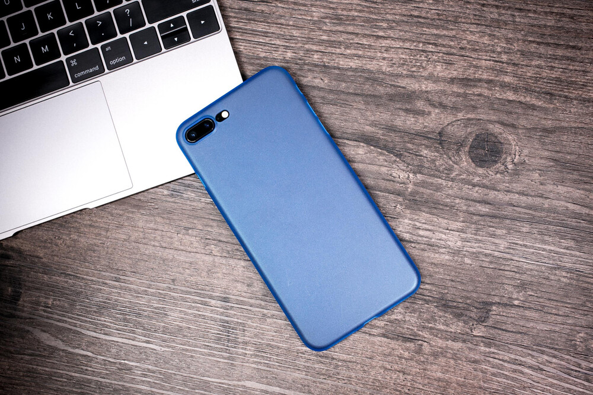

Muistatko, miten ihanalta tuntuu uudenkarhea puhelin? Saman tunteen voit saada myös paljon pienemmällä investoinnilla: uusilla puhelimenkuorilla. Sen helpompaa tapaa piristää matkapuhelintasi ei ole. Uudet kuoret, kuin uusi puhelin! Puhein on esine, jota käytät kenties enemmän kuin mitään muuta koko päivän aikana. Se ansaitsee hyvät kuoret ympärilleen ja pienen taloudellisen satsauksen, joka maksaa itsensä moninkertaisena takaisin.

## Vaihtele mielialan mukaan

Koska kuoret ovat helppo ja halpa investointi, niitä voi helposti vaihdella oman fiiliksen mukaan. Voit kokeilla vaihtaa kuoria myös tilanteeseen tai tyyliisi sopiviksi ja yllättyä, kuinka suuri vaikutus sinänsä pienellä muutoksella on! Pienet yksityiskohdat viimeistelevät kokonaisuuden ja vanha viisaus pätee myös puhelimen kuorien suhteen. Ethän käytä joka päivä samanlaista kampausta tai vaatteita. Miksi siis käyttäisit joka päivä samanlaista puhelinta? Onko tänään pinkki vai musta päivä? Raidallinen vai pilkullinen? Villi vai rauhallinen?

## Valitse rauhassa tai ota monta

Parasta puhelimen kuorien valinnassa on se, että saa oikeasti valita: voit puntaroida erilaisten vaihtoehtojen välillä. Shoppailukokemus on osa hauskuutta, ei vain välttämätön paha oikean tuotteen löytämiseksi. Kun sen voi tehdä rauhassa, stressitaso pysyy matalana ja saat kivan pienen hengähdystauon arjesta. [Skalhuset](https://skalhuset.fi/) tarjoaa laajan valikoiman erilaisia kuoria. Olemmehan erilaisia ihmisiäkin, miksi kaikkien puhelimien pitäisi näyttää samoilta, eli suoraan sanottuna vähän tylsiltä.

## Tyylin lisäksi järkeä

Suojakuoret eivät ole vain tyylilyylin valinta, vaan myös fiksun kuluttajan merkki. Ne nimensä mukaisesti suojaavat puhelintasi vaurioilta, jotka syntyvät esimerkiksi laitteen pudotessa. Puhelin on paitsi taloudellisesti arvokas, se myös sisältää paljon sinulle tärkeitä, ainutlaatuisia ja korvaamattomia muistoja: kuvia, yhteystietoja, videoita ja niin edelleen. Haluat varmaankin pitää tämän kaltaiset aarteesi turvassa, eikö vain?

## Hyvä ote kädestä

Viimeisenä vaan ei vähäisimpänä syy puhelinkuorien päivittämiseen on käyttömukavuus. Mietipä, miten paljon pidät puhelinta kädessäsi! Ei ole yhdentekevää, millainen otteesi puhelimestasi on ja kuinka mukavasti se pysyy kädessä. Valitsemalla sinulle ja sinun tarpeisiisi sopivat puhelimen kuoret, varmistat myös, ettei otteesi lipeä eivätkä sormesi väsy.
