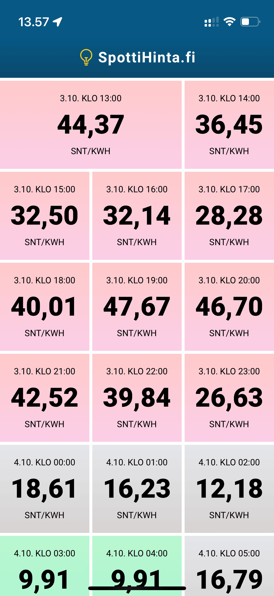

On tullut taas koodailtua omia tässä iltasella ja töiden ohessa. Näistä koodailuista syntyi [SpottiHinta.fi](https://spottihinta.fi/) sivu. No kerrotaan nyt hieman mitä on koodattu eikä vain tuota osoitetta.

Sähkön hinnat ovat mitä ovat ja markkinat ovat sekaisin. Itsellä loppui sopimus 30.9. ja siihen piti sitten saada toinen ja sattumusten kautta olenkin nyt pörssisähkössä.

Halusin tavan seurata pörssisähköä helposti puhelimella ja nähdä spot-hinnat ja näin hieman ehkä miettiä laitanko sitä saunaa lämpiämään vaiko en. Pari viikkoa sitten ei ollut iOS puhelimelle kunnollisia pörssisähkön hinnan näyttäviä appeja ja en tykännyt silloin saatavilla olevasta Tuntihinta appista. Päätin siis tehdä oman version, jonka saa pwa tyylisesti ”appiksi” lisäämällä sen kuvakkeen kotivalikkoon. Näin siis saan appi tyylisesti spot-hinnat näkyviin helposti.

Mulla oli siis tarve saada ”dashboard” tyyppisesti tulevat spottihinnat näkyviin ja näin teinkin ”linkki generaattorin”, jolla voi luoda listauksen oli sitten kyse puhelimesta tai vaikka televisiosta.

Hintoja haistellaan koko ajan ja seuraavan päivän spot-hinnat tulevat Nordpoolin datan kautta yleensä kahden aikaan. Näin voidaan suunnitella hieman seuraavaa päivää eli kannattaako sitä saunaa lämmittää vaiko ei.

Sivua on jo nyt kehitetty hieman palautteen perusteella ja sitä kautta onkin saatu hinnat sivu uusittua ja tehtyä muutakin pientä parannusta.

Tämähän on koodattu käyttäen Laravelia ja Livewireä. Tulikin opittua lisää tuosta Livewirestä sillä sitä on hieman vähemmän tullut käytettyä. Sen kanssa saakin tehtyä mukavia toimintoja, kuten tuo Alv. prosentin vaihtaminen vaihtaa hinnat auki olevalla sivulla.

Omat projektit on aina mukavia ilta/viikonloppu projekteja joita koodaillaan kun/jos aikaa sattuu olemaan.

Osoitehan oli siis yksinkertaisuudessaan [SpottiHinta.fi](https://spottihinta.fi/) ja käyttäminen on täysin ilmaista.
