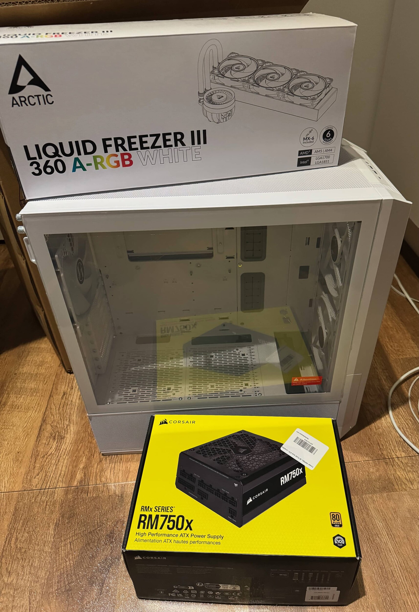
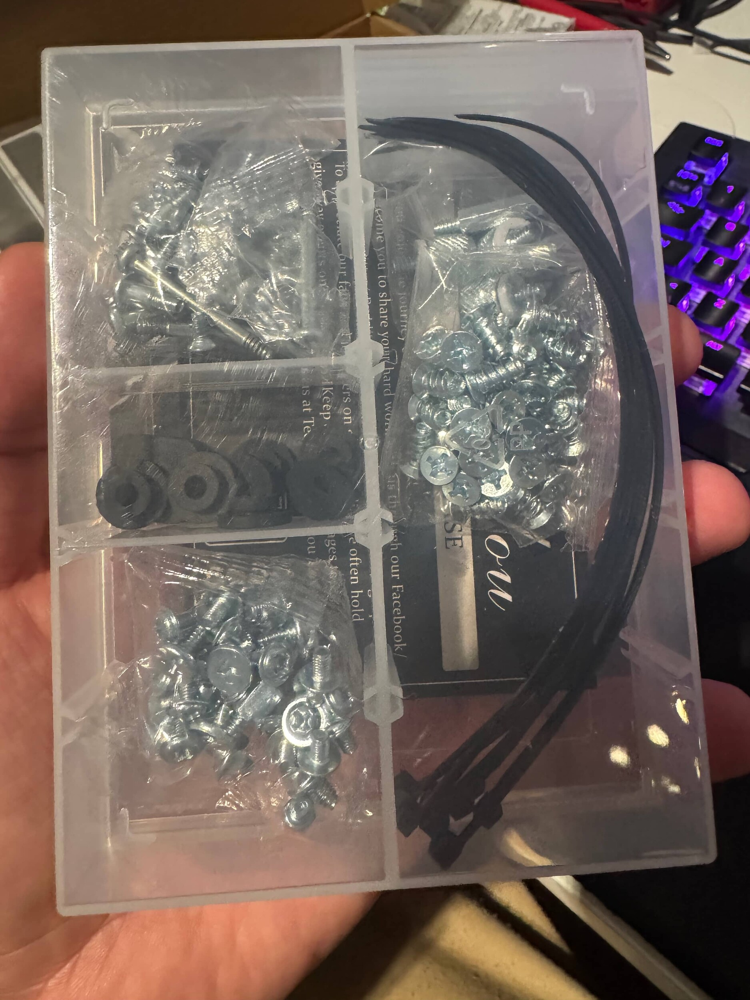
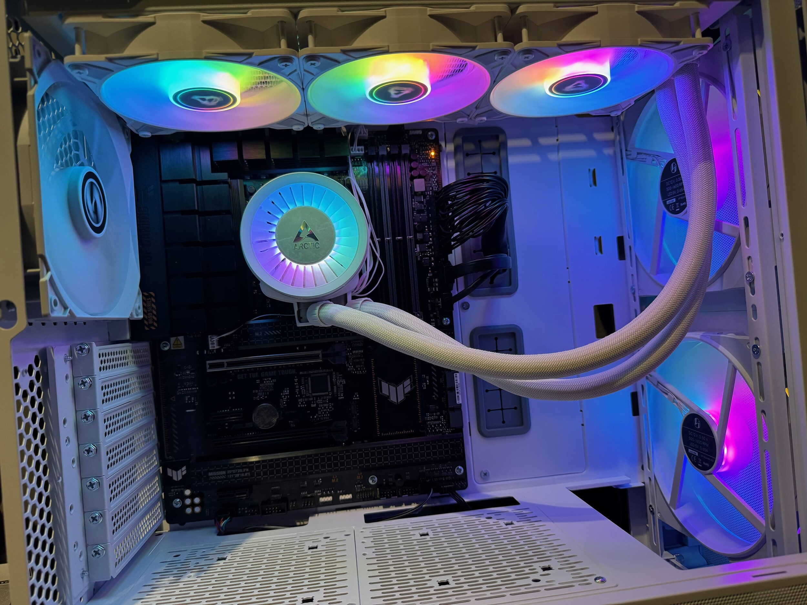

Nyt tuli taas osaa postissa ja päästiin hieman jo kasaamaankin ja katsomaan saadaanko jotain ihan jopa päällekkin.
{.lead}

Nythän ollaan myös siinä tilanteessa, että on oikeastaan tuon [myytävän läppärin](https://www.tori.fi/profile/ads?userId=2145755174) verran osia ostamatta. Vielä siis uupuu näytönohjain, muistit sekä kovalevy.

## Virtalähde: Corsair RM750x
Tämä löytyi myös Verkkokauppa.comin outletista hintaan 83 euroa (+ postit). Eli tässäkin saatiin ihan kivaa säästöä. 

Outletin ja käytetyn ostaminen jännittää aina ja tässäkin jännitti onko kaikki piuhat mukana vai uupuu jotain tärkeää. Ei näyttänyt uupuvan ja homma näyttää hyvältä.

Päädyin tähän virtalähteeseen hinnan lisäksi 10v (vajaa) takuun takia ja sen takia, että tuolla on ihan hyvää arvosteluakin ollut. 750 W riittää kyllä tämän setin pyörittämiseen ihan hyppien keikkuen ja jos tulee joskus tarve isompaan päivittää niin sitten katsotaan.

## Kotelo: Lian Li LANCOOL 216 RGB E-ATX-kotelo

Kotelo olikin yksi haastavimmista osista tilata ja tässä meni omat ajatukset 60-80 euron kopasta yli reippaasti, hintaa tuli lopulta 103.99 euroa (+ posteja). Halusin nimittäin, että matkassa olisi USB-C portti sekä tuulettimiakin. Näin niitä ei tarvitsisi ostaa erikseen. Halusin myös valkoisen sekä lasikyljellä olevan.

Lopulta päädyin Lian Li:n lancool 216 koteloon johon olen näin ensivaikutelman jälkeen oikein tyytyväinen. 

Matkassa tuli takatuuletin ja kaksi isompaa etutuuletinta. Onhan tuo nyt minun mielestä tyylikkään näköinenkin.

Koteloa en uskaltanut ostaa käytettynä tai outletista sillä tässä mietin mitä kaikkea voi oikein uupua loppujaan ja ehkä paras ostaa uutena tämä.

## Prosessorin jäähdytin: Arctic Liquid Freezer III 360 ARGB

Minullahan oli suunnitelmat mennä ilmajäähyllä, mutta nyt lähti mielenkiinto ja omat mielihalut rullaamaan. Pohdin, että jossain välissä haluaisin päivittää AIO (all in one) vesijäähdytykseen ja sitten mietin miksi en suoraan hanki sitä.

Tätäkin olisi ollut outletissa, mutta tuli sama ajatus mieleen kuin kopan suhteen. Ehkä parempi uutena niin on ainakin kaikki kiinnitystarpeet mitä tarvitaan. Ikävä olisi jos joku osa uupuu jota tarvitsisi kiinnittämiseen.

Tää onkin itselle eka kerta, kun AIO tai minkäänlaisen vesijäähdytyksen kanssa pelaan. Tässähän ajatus on, että veden avulla lämpö siirretään jäähdyttimeen jota sitten tuulettimet viilentää ja näin neste siellä sisällä viilenee.

## Pistetään jo hieman konetta kasaan

No pitihän se konetta pistää kasaan jo näillä osilla. Minulla kuitenkin oli sen verran osaa, että saan jo hieman tietokonettakin kasaan.

Kiva yllätys oli myö se, että kotelon matkassa tuli muovinen rasia mihin saan laitettua ruuvit järjestykseen. Pieni ja halpa asia mutta niin hyvä fiilis tulee tästä. Eipähän tarvitse itse 3D-tulostaa tätäkään.

Olen kasannut viimeksi tietokoneen useampi vuosi sitten ja onhan se mynnettävä, että moderneilla osilla on nykyään ihan kiva kasata konetta. Kopassa on tilaa työskennellä ja johdot saa kivasti hallintaan.

Koteloon saatiin oikeastaan kasattua kaikki osat mitä olin jo hankkinut eli emolevy, prosessori, virtalähde sekä prosessorin jäähdytin.

Sen verran saa konetta myös käyntiin, että nähdään toimiiko yleensä jokin ja mitä mahdollista virhettä emolevyn ilmoitusvalot antaa. 

Sehän heräsi eloon ja vähemmän yllättäen oli päällä merkkivalo muisteista. Koska ei ole prosessorissa integroitua näytönohjainta niin en saa kuvaa ruudulle ja kun ei vielä ole näytönohjainta. 

Eka bootti oli kuitenkin suhteellisen positiivinen ja saatiin valojakin näkyviin. Itsehän kytkin nuo rgb valot kaikki samaan kotelon mukana tulleeseen rgb / tuuletin jako levyyn/hässäkkään ja siitä sitten yksi piuha rgb pinniin emolevyssä. Näin sain ainakin nämä kaikki valot (oletettavasti) saman hallinnan alle ja siksipä nuo valot onkin kaikissa samaa. On se tekniikka ihmeellistä 😀

## Black weekkiä odotellessa

Vielä viimeisten osien tilausta odotellaan ja toivon, että tuo kone menisi kaupaksi niin saisi budjettiakin siihen. Ostettavana on siis näytönohjain, muistit sekä kovalevy.

Hyvällä tuurilla voin saada suhteellisen hyviä tarjouksia Black weekkinä tai black fridaynä.

Asiaa ei auta se, että pientä "näyttökuumetta" pukkaa myös sillä 1440p pelaaminen on se tavoite tällä kokoonpanolla ja löytyi hyvä tarjous 32 tuumaisesta 1440p näytöstä... Ehkä maltan odotella black fridayhin ja nähdään sitten mitä tulee ostettua vai tuleeko mitään. Sanotaanko näin, jos olisi pelikannettava myytynä niin olisi ehkä näyttö tullut haettuakin...

Ehkäpä tämä kone joskus valmistuu ja päästään pelaamaan hieman tehokkaammalla koneella.
