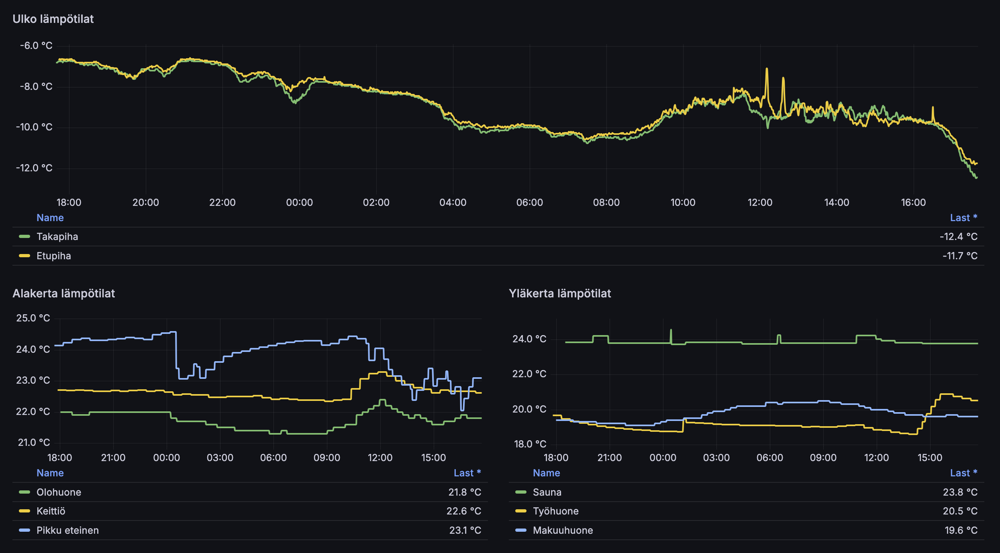

Nyt mennään hieman nörtimpään suuntaan ja lähdetään käymään läpi miten vaihdoin Home Assistantin tietokannan oletusarvoisesta SQLite tietokannasta MariaDB ja InfluxDB tietokantoihin. Näin jälkiviisaana tämä olisi ollut hyvä tehdä alusta asti.
{.lead}

Tavoitteena on saada Home Assistant käyttämään MariaDB tietokantaa jossa olisi 7 tai 14 päivän verran dataa (en ole vielä päättänyt). Sitten pitkäaikainen data olisi InfluxDB tietokannassa ja Grafanan kautta selattavissa. 

Harvemmin tulee Home Assistantin kautta historiadataa katseltua ja nyt voin määritellä InfluxDB tietokantaan vain sen datan mitä haluan selata eli käytännössä lämpötiloja ja sähkön kulutustietoja. Tällä hetkellä pääkiinnostus on lämpötiloissa. Tätä voi kuitenkin säätää tulevaisuudessa jos tulee laitteita joiden arvoa haluan seurata.

Parasta näiden Home Assistanttien ja avointen systeemien kanssa on se vapaus, että voin tehdä miten ja mitä haluaa.

Sen vielä sanon ennen kuin alan säädöstä kertomaan, että päätin etten ala tuomaan SQLite kannasta tietoa sillä itsellä oli muutos menossa ZHA:sta Zigbee2MQTT ja siinä vaihdoin kaikkien ZigBee laitteiden nimet. Näin olisi pitänyt tehdä jotain yhdistelyä yms. säätöä mitä en olisi jaksanut.

## Aloitetaan säätö

Minullahan on Home Assistant asennettuna Docker composen kautta ja jaankin tässä tuon minun `docker-compose.yml` tiedoston sisällöt koskien tätä projektia. Samoin minulla on tämä asennus polussa `/opt/homeassistant` joten jos otat mallia niin ota oma ympäristö huomioon.

No niin aloitetaan. Luodaan ensin `.env` tiedosto `/opt/homeassistant` kansion juureen. Sinne pistetään hieman tunnuksia ja salasanoja.

```dotenv
MYSQL_ROOT_PASSWORD="MariaDB root salasana"
MYSQL_HA_DATABASE="MariaDB tietokannan nimi esim. homeassistant"
MYSQL_HA_USER="MariaDB tietokannan käyttäjä esim. homeassistant"
MYSQL_HA_PASSWORD="MariaDB homeassistant käyttäjän salasana"

INFLUXDB_USER="InfluxDB käyttäjä esim. homeassistant"
INFLUXDB_PASSWORD="InfluxDB käyttäjän salasana"
INFLUXDB_ORG="InfluxDB organisaatio esim. Koti"
INFLUXDB_BUCKET="InfluxDB bucket esim. homeassistant"
```

Sit voidaankin lisätä `docker-compose.yml` tiedostoon kaikki mahdollinen. Kannattaa ensin pistää Home Assistant kontti alas jos sellainen vielä pyörii. 

Alla onkin minun tiedosto, jossa on määritettynä tosiaan seuraavat kontit:

- Home Assistant
- MariaDB
- InfluxDB
- AdminerEvo
- Grafana

Minulla on myös luotuna kansiorakenne tuossa tiedostossa määritetyillä poluilla. 

```yaml
version: "3"
services:
  homeassistant:
    container_name: homeassistant
    image: "ghcr.io/home-assistant/home-assistant:stable"
    volumes:
      - /opt/homeassistant/config:/config
      - /etc/localtime:/etc/localtime:ro
      - /run/dbus:/run/dbus:ro
    restart: unless-stopped
    privileged: true
    network_mode: host
    depends_on:
      - influxdb2
      - mariadb
  mariadb:
    container_name: mariadb
    image: mariadb
    restart: unless-stopped
    ports:
      - 3307:3306
    environment:
      - TZ=Europe/Helsinki
      - MYSQL_ROOT_PASSWORD=${MYSQL_ROOT_PASSWORD}
      - MYSQL_DATABASE=${MYSQL_HA_DATABASE}
      - MYSQL_USER=${MYSQL_HA_USER}
      - MYSQL_PASSWORD=${MYSQL_HA_PASSWORD}
    volumes:
      - /opt/homeassistant/mariadb/data:/var/lib/mysql
      - /opt/homeassistant/mariadb/config/:/etc/mysql/conf.d
  influxdb2:
    container_name: influxdb2
    image: influxdb:2
    restart: unless-stopped
    ports:
      - 8086:8086
    environment:
      - TZ=Europe/Helsinki
      - DOCKER_INFLUXDB_INIT_MODE=setup
      - DOCKER_INFLUXDB_INIT_USERNAME=${INFLUXDB_USER}
      - DOCKER_INFLUXDB_INIT_PASSWORD=${INFLUXDB_PASSWORD}
      - DOCKER_INFLUXDB_INIT_ORG=${INFLUXDB_ORG}
      - DOCKER_INFLUXDB_INIT_BUCKET=${INFLUXDB_BUCKET}
    volumes:
      - /opt/homeassistant/influxdb/data:/var/lib/influxdb2
      - /opt/homeassistant/influxdb/config/:/etc/influxdb2
  adminer:
    container_name: adminer
    image: ghcr.io/shyim/adminerevo:latest
    restart: unless-stopped
    depends_on:
      - mariadb
    ports:
      - 8180:8080
    environment:
      - TZ=Europe/Helsinki
      - ADMINER_DEFAULT_DRIVER=server
      - ADMINER_DEFAULT_SERVER=mariadb
      - ADMINER_DEFAULT_USER=${MYSQL_HA_USER}
      - ADMINER_DEFAULT_PASSWORD=${MYSQL_HA_PASSWORD}
      - ADMINER_DEFAULT_DB=${MYSQL_HA_DATABASE}
  grafana:
    container_name: grafana
    user: "1000:1000"
    environment:
      - TZ=Europe/Helsinki
    image: grafana/grafana:latest
    restart: unless-stopped
    volumes: 
      - /opt/homeassistant/grafana:/var/lib/grafana
    depends_on:
      - influxdb2
    ports:
      - 3000:3000
```

Vielä ennen kuin nostelin kontteja ylös niin piti tehdä pari lisäystä Home Assistantin `secrets.yaml` tiedostoon, jotta saadaan pari määritystä sinnekin.

Ensin pitää lisätä sinne MariaDB määre. Tuossa korvaa nuo isoilla kirjaimilla olevat omilla määreilläsi.

```yaml
mariadb: "mysql://MYSQL_HA_USER:MYSQL_HA_PASSWORD@IP:PORTTI/MYSQL_HA_DATABASE?charset=utf8mb4"
```

Nyt pitäisi ensin muokata pari riviä tuohon Home Assistantin `configuration.yaml` tiedostoon, jotta saadaan MariaDB yhteys toimimaan.  Tuossa on recorder määre ja tähän löytyy dokumentointia Home Assistantin [sivuilta](https://www.home-assistant.io/integrations/recorder/). Mulla on tuossa myös purgen päivien määrä. Oletuksena tuo on 10.

```yaml
recorder:
  db_url: !secret mariadb
  purge_keep_days: 14

history:
```

Nyt voidaankin nostaa jo kontit ylös. Ja nyt pitäisi sinulle toimia MariaDB yhteys. Voit käydä katsomassa Adminerin kautta meneekö sinne dataa. 

Mutta nyt pitäisi sitten vielä InfluxDB saada toimimaan. Noh tätä varten sun pitää käydä luomassa Token siellä InfluxDB puolella. Se sitten käydään pistämässä taas sinne `secrets.yaml` tiedostoon.

```yaml
influxdb_host: "IPOSOITE"
influxdb_token: "InfluxDB puolella luotu token"
influx_org: "InfluxDB organisaatio minkä määritit myös Dockeriin"
```

Sitten vielä määritetään tuo InfluxDB yhteys Home Assistantin `configuration.yaml` tiedostoon. Tästäkin on ohjetta vielä lisää Home Assistantin [sivuilla](https://www.home-assistant.io/integrations/influxdb/) ja itse olenkin määrittänyt sen alla olevaan tapaan.

Minulla menee vain sensorit missä on nimissä _energy, _temperature ja _power loput. Nämä kiinnostaa minua eniten. Voin tarpeen mukaan muokata ja lisätä niitä.

```yaml
influxdb:
  api_version: 2
  ssl: false
  host: !secret influxdb_host
  port: 8086
  token: !secret influxdb_token
  organization: !secret influx_org
  bucket: homeassistant
  tags:
    source: HomeAssistant
  tags_attributes:
    - friendly_name
  default_measurement: units
  include:
    entity_globs:
      - sensor.*_energy
      - sensor.*_temperature
      - sensor.*_power
```

Nyt voit halutessasi napata vielä kontit alas ja takas ylös. Tämä muutos voi myös mennä päälle käynnistämällä pelkkä HA uudestaan kehittäjän asetusten alta.

## Entäs sitten

No nyt voitkin alkaa säätämään. Tai no kunhan sitä dataa tulee niin voi alkaa isomminkin säätämään.

Sinun pitää tietysti yhdistää Grafana ja InfluxDB, jolloin saat Grafanalla tehtyä vaikka sun minkälaista käppyrää ja säätöä... Siinä on kyllä hurjasti eri mahdollisuuksia ja työkaluja. En itsekään ole siitä vielä ihan kaikkea mahdollista potentiaalia kerennyt tutkimaan, mutta ekat graafit vaikuttaa jo tosi lupaavilta. Alla onkin nopeat säädöt mitä tein lämpötiloista.



Tuon kanssa voisi säätää ja pitää säätää lisääkin. Nyt varsinkin kun alkaa tuota dataa olla siellä niin voi saada mielenkiintoisempiakin graafeja ja mitä nyt keksiikään.

Noitahan voi upottaa myös Home Assistantin dashboardeille, kun säätää hieman konffeja taas, joten saisi noita helposti näkyviinkin.

## Kannattiko?

No oikeastaan joo. Voisi melkein tiputtaa tuon Home Assistantin MariaDBseen tallentavan datan määrän 7 päivään. Itsellä ei kuitenkaan ole tarve säilöä tuota dataa ja ei ole mitenkään ongelma jos se sattuu nyt katoamaankaan.

Nyt pitäisi vielä melkein tehdä joku varmuuskopiointi MariaDB ja InfluxDB datalle. Ei ehkä huono ajatus tämäkään, tästähän tulee sitten varmaan blogia... 🤔

[Mastodonissa](https://kaartinen.social/@marko) oli puhetta kuormasta ja oliko tästä nyt sinällään hyötyä. SQLitehän on toimiva ja nykyisillä nopeilla kiintolevyillä ei tuonkaan käyttö olisi ongelma. Varsinkin jos rajoittaa datan määrää tuolla ja sitten pistäisi juuri InfluxDB pitkäaikaisen datan säilytykseen. Kuormaa en ole kauheammin seurannut ennen tai jälkeen sillä tuolla läppäripalvelimella on resursseja käytettävissä ja sinällään siitä ei tällä hetkellä ole pulaa. 

Ei tämä varmaan kaikille kävisi sillä tuo SQLite on vain helpompi tapa toimia. Eikä tuo MariaDB ole mitenkään välttämätön. Itse jotenkin tykkään ehkä enemmän siitä, että on oma kanta kontti pyörimässä.

Toki tässä tehdään asiasta taas hieman monimutkaisempi, mutta hei tämä on tätä selfhosted mentaliteettia, että tehdään koska voidaan ja siitä säätämisen ilosta. **Tämä nyt sattuu olemaan ihan mukavaa puuhaa.**
