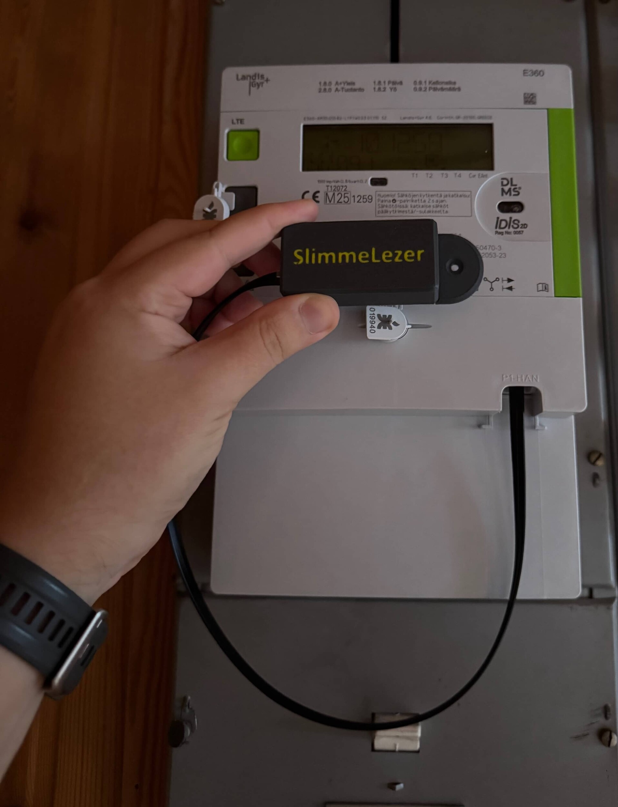
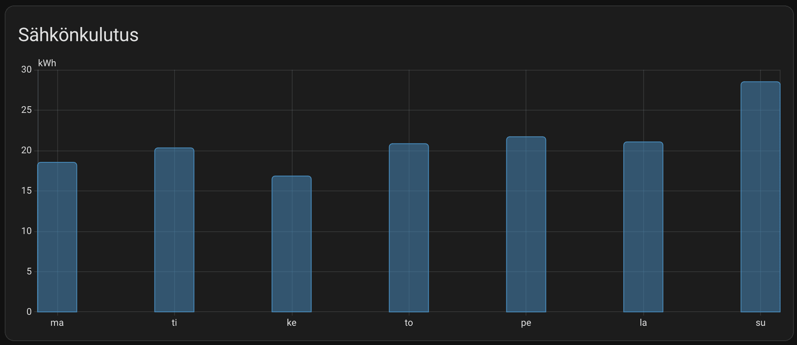
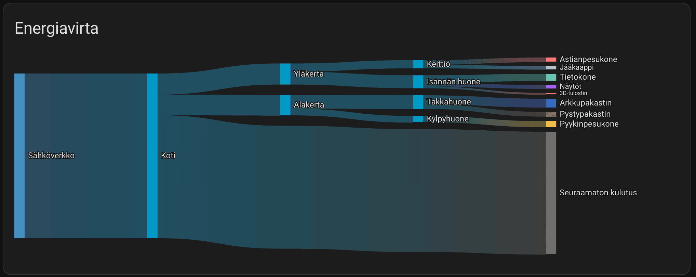
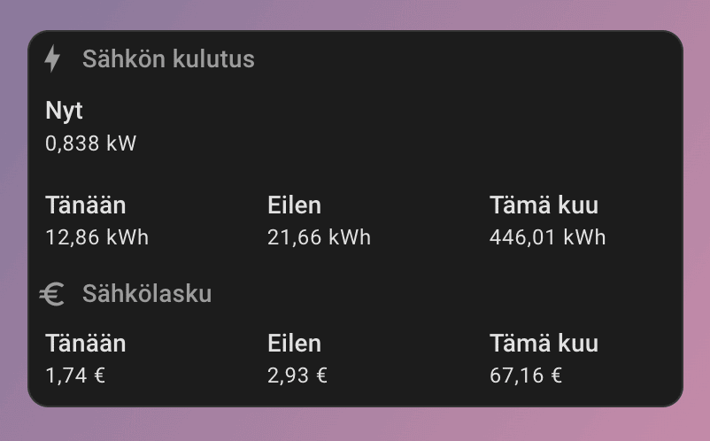

Kun ostettiin tämä talo niin sähkönkulutuksen seuranta oli yksi asia mihin haluan lähteä kiinnittämään huomiota. Tähän sainkin heti suosituksen ja se oli SlimmeLezer+ laita, joka kytketään sähkömittariin ja näin saadaan sitten reaaliaikaista tietoa sähkönkulutuksesta Home Assistantin kautta.
{.lead}

## Mikä on SlimmeLezer+?
SlimmeLezer on ESPHome pohjainen laite, joka kytketään suoraan sähkömittarin P1 HAN porttiin. Tämän jälkeen se lähettää reaaliajassa tietoa sähkönkulutuksesta Home Assistanttiin. Tämä myydään ilman koteloa ja itse toki 3D tulostin tälle kotelon. Posteineen tämä maksoi vajaa 35 euroa. Eli ei kovin arvokas investointi.

SlimmeLezerin voit tilata suoraan heidän sivuilta osoitteesta: [zuidwijk.com](https://www.zuidwijk.com/product/slimmelezer-plus/)

## SlimmeLezer+ asennus sähkömittariin
Tämä ei suoraan vanhaan mittariin onnistunutkaan. Kuopion Energialle kuitenkin iso kiitos siitä, että mittarin vaihto uudempaan onnistui helposti ja nopeasti sekä vielä ilman kustannuksia. Uudemmassa mittarissa on siis tuo P1 HAN portti valmiina ja näin SlimmeLezer+ laite saatiin kiinni siihen.

## Sähkönkulutuksen seuranta Home Assistantissa
SlimmeLezer+ laite on ESPHome pohjainen ja näin se on helppo liittää Home Assistantiin. ESPHome integraation kautta laite löytyy automaattisesti ja sen jälkeen vain lisätään ESPHome laite Home Assistantiin. Tämän jälkeen sähkönkulutuksen seuranta onkin heti käytössä.

Home Assistantissa on oma energia "dashboard", johon, kun lisää sähkönkulutuksen niin saa sitten näkyviin sähkönkulutusta esim. tunneittain tai päivittäin tai miten nyt haluaakaan. Alla olevassa kuvassa on nyt esimerkkinä viikon ajalta päivittäinen sähkönkulutus.

Itsellä, kun on yksittäisiä pistokkeita, jotka osaa mitata sähkönkulutusta niin ne on myös lisättynä tänne energia "dashboardille" ja näin saadaan myös yksittäisten laitteiden kulutusta näkyviin. Harmillisesti ilmalämpöpumppu ei ole itsellä seurannassa, mutta sen voisi ehkä joskus saadakin.

Mutta alla oleva energiavirta kuvaaja onkin hauska, sillä näet miten paljon kulutuksesta on tällä hetkellä seuraamatonta ja miten paljon mikäkin seurattu osa kuluttaa.

Koska minulla on tiedossa reaaliaikainen sähkönkulutus ja pystyn ottamaan tämän ja eilisen päivän kulutuksen ja tein siitä sitten kortin. Tässä on myös otettu huomioon sähkönhinta sillä itsellä on nyt kiinteä sopimus pörssin sijaan sillä halusin ensimmäiseksi vuodeksi kiinnittää hinnan jotta opin hieman miten talo kuluttaa sähköä ja näin ei tule isoa yllätystä pörssisähköllä, jos talvella on kallista.

Alla olevaan korttiin onkin huomioitu sähkönhinta ja siinä on myös siirron osuus huomioituna. Näin näen osviittaa minkälaista sähkölaskua on tulossa tältä kuulta.

## Ne kuuluisat loppulätinät

Tämä on kyllä erittäin helppo tapa seurata kulutusta, kun käytössä on jo Home Assistant. Käytännössä yhdellä piuhalla saadaan reaaliaikainen sähkönkulutuksen seuranta ja voit tehdä sitten mitä haluatkaan sillä datalla Home Assistantin puolella.

Tulevaisuudessa olisi ajatus vielä laajentaa veden ja kaukolämmön seurantaan.
