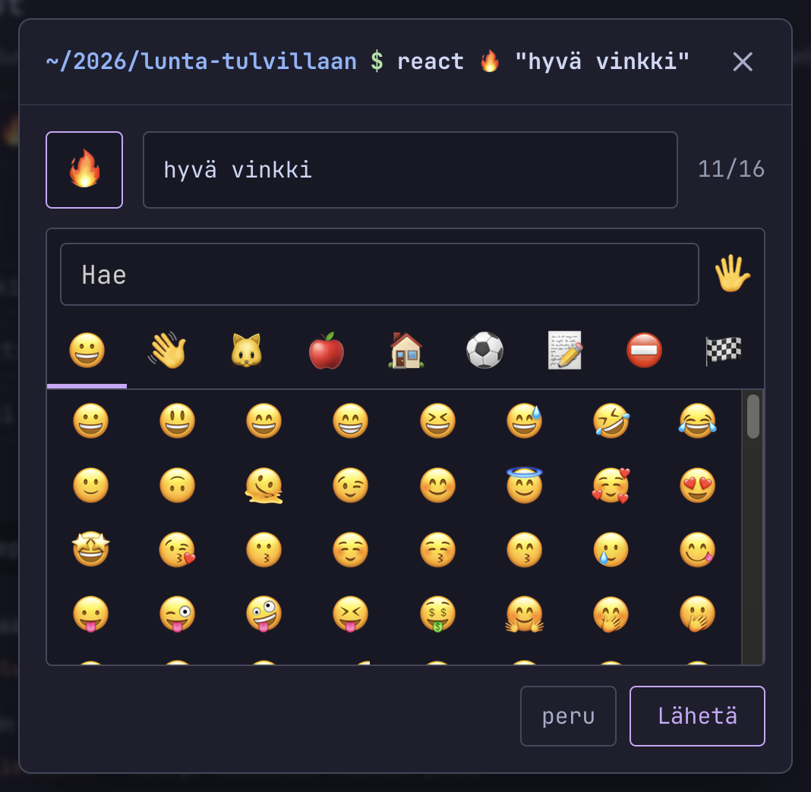

Taas uutta hauskaa ominaisuutta sisään! Nyt voit reagoida anonyymisti artikkeleihin!
{.lead}

[Discoursessa](https://www.discourse.org/) oli joskus kokeilussa ominaisuus nimeltä Boostit. Tykkäsin itse tosta ajatuksesta, että voit jättää emojin ja lyhyen kommentin. Halusinkin sen tuoda tähän blogiin kanssa toimintaan.

Nyt voitkin blogin artikkeleihin jättää anonyymisti joko pelkän emojin tai lisätä siihen lyhyen kommentin.

")

Pikarivillä on kahdeksan emojia ja lisää löytyy sitten reagointi-ikkunasta. Emojivalitsin on [emoji-picker-element](https://github.com/nolanlawson/emoji-picker-element), joka hostataan omalta palvelimelta eikä ulkoisia palveluita käytetä.

Omaa reaktiota voi vielä muuttaa lähettämisen jälkeen jos sattui lipsahtamaan typo tai väärä emoji. Uuden reaktion lähetys korvaa edellisen, jos kerkesit jo reagoida (voit toki poistaa oman reaktion). Reaktioita voi lähettää yhden per artikkeli per käyttäjä, toki tuonkin voi kiertää, jos oikein haluaa.

Reaktiot näkyvät artikkelin alla emojeittain koottuina ja viestilliset omina badgeinaan (kuten yllä olevassa kuvassa näkyikin).

Reaktioihin käytetään samaa rajapintaa mikä tehtiin esim. [vieraskirjaa](/vieraskirja) ja [joulukalenteria](/joulukalenteri) varten. Spämmiä koitetaan estää ohjelmallisesti sekä reaktioita moderoidaan myös, joten voin poistaa asiattomat reaktiot.

Yksityisyydestä sen verran, että reaktiot ovat täysin anonyymejä eikä niissä käytetä evästeitä. Selaimeesi tallentuu vain satunnainen tunnus, jolla tiedetään että olet jo reagoinut. Palvelin säilyttää tunnuksen ja IP-osoitteesi vain salattuina tiivisteinä spämmin torjuntaa varten. Tällä ei voi tunnistaa kuka sinä olet.

Kommentointi onnistuu edelleen Mastodonissa ja tämä reagointi tuli sen rinnalle. Jatkokehityksenä tähän voisi miettiä esim. suosittuja reaktioita etusivulle tai eniten reagoituja artikkeleita jonnekin.

**Kokeile vapaasti, vaikka tähän artikkeliin!**
