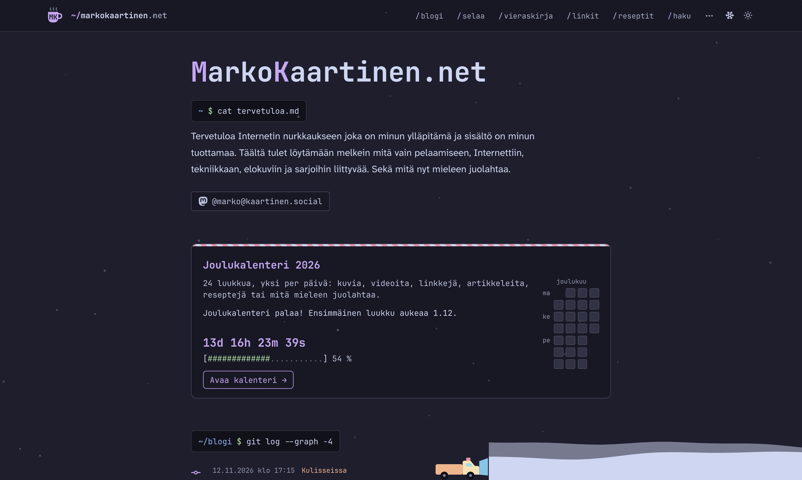

Kuten [aiemmin](/2026/jotain-uutta-ja-jotain-vanhaa) mainitsin niin joulukalenteri tekee paluun tälle vuodelle. Talvi tuli myös tänne blogin puolelle!
{.lead}

Nyt on blogiin ja omaan rajapintaan tehty jo tuki tälle [joulukalenterille](/joulukalenteri) ja saas nähdä miten paljon bugeja tästä löytyy sitten joulukuun aikana.

Talvesta ja joulusta tuli kuitenkin jo viitteitä tänne sivuille, kun etusivulle tuli laskuri itse kalenterista sekä alkoi satamaan lunta. Lumihan kertyy tuonne alalaitaan, joten muista kolata se pois!

Lumihiutale-ikonista saat lumen pois (tai valot päälle) ja selaimen pitäisi muistaa tämä valinta. Joulukalenteri sivulla on jo täys joulu päällä valojenkin suhteen!

## Ehdota sisältöä kalenteriin

Kalenterissa ei vielä ole sisältöä tai oikeastaan sitä ideoin vielä. Nyt onkin oiva aika ehdottaa sisältöä tuohon kalenteriin!

En vielä tarkalleen tiedä mitä tulee olemaan, mutta jotain vähän kaikille. Joskus aikanaan oli ihan oma sovellus tähän ja siellä oli kuvaa ja videota ja tämmöistä.

Nyt jos on joku hauska ajatus niin pistä viestiä [Mastodonissa](https://kaartinen.social/@marko) tai [sähköpostilla](mailto:markokaartinen@gmail.com)! Voit suoraan tämän artikkelin Mastodon postaukseen vastata, johon löytyy linkki tuolta alhaalta, kun se postaus on julki.

**Mukavaa joulun odotusta!**
