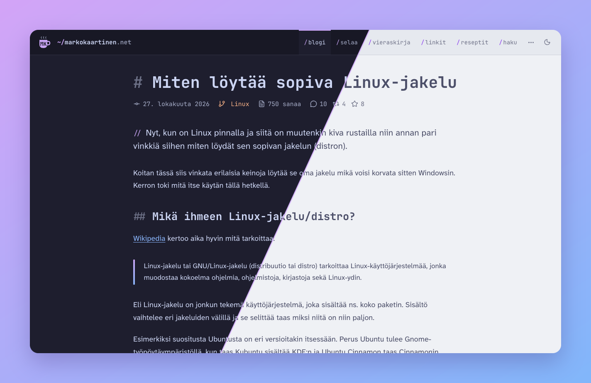
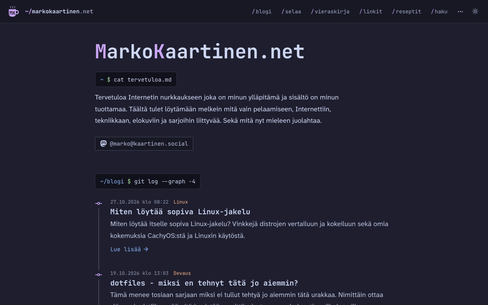
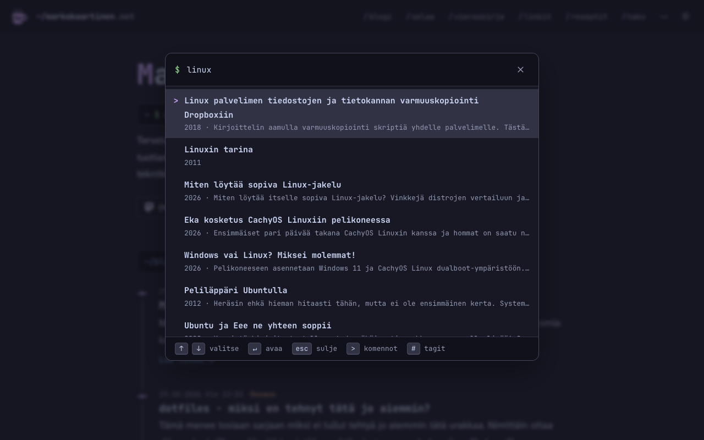
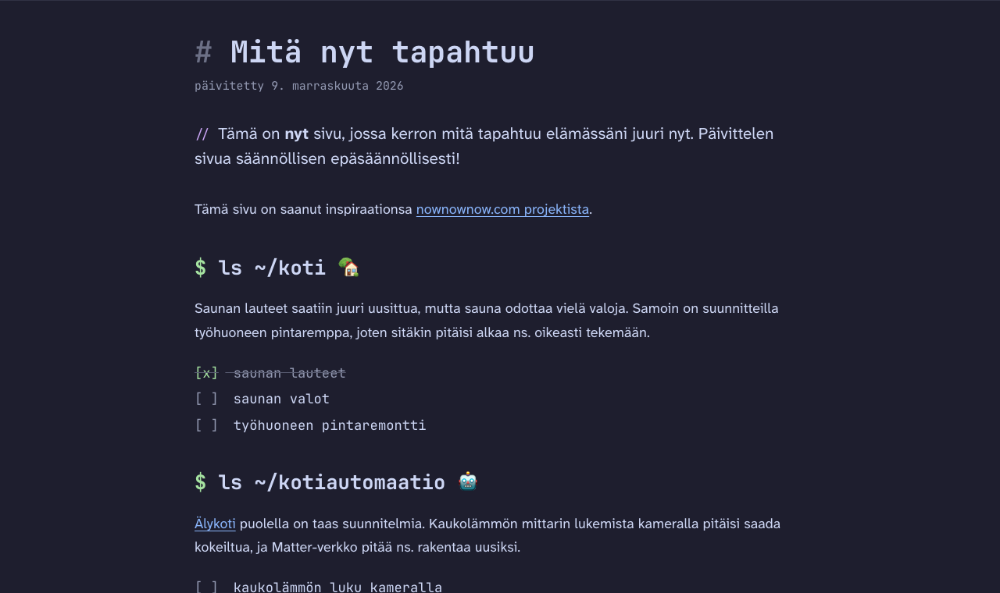
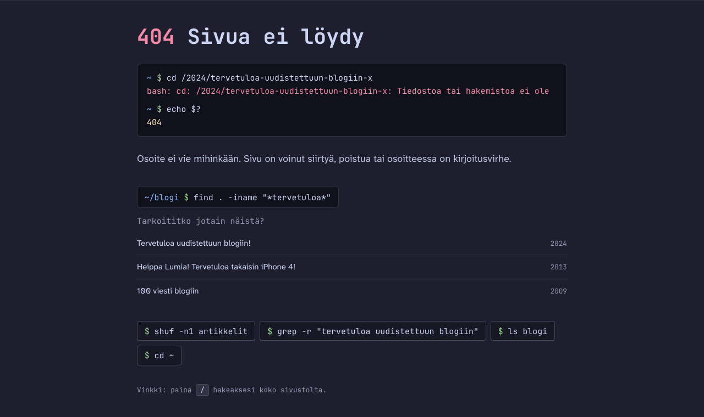

Tervetuloa uudistettuun MarkoKaartinen.net-blogiin! Tällä kertaa mennään vielä enemmän staattiseen suuntaan, tosin pienellä twistillä.
{.lead}

Edellinen isompi uudistus oli vuonna [2024](/2024/tervetuloa-uudistettuun-blogiin), kun vaihdoin WordPressin Laraveliin.

## Historian havinaa

Tätä versiota tehdessä piti ihan tarkistaa taas, mistä kaikki alkoi. Domainin sain 2005 alkuun ilmaiseksi pariksi vuodeksi, kun olin työharjoittelussa eräässä webbilafkassa. Siellä aloittelin myös PHP:n koodailua ja tein omat sivut harjoituksena muiden töiden ohella. Sivusto on siis yli 20 vuotta vanha.

Vuodesta 2007 lähtien täällä on ollut WordPress ja aina vuoteen 2024 asti sivusto pyöri pitkälti sen päällä. WordPress tuli valittua jo silloin, koska se oli tehty tutulla PHP:llä, siihen sai tehtyä omia teemoja ja hallinta oli helppoa.

Sitten tuli Laravel-versio, jossa muunsin WP-artikkelit markdown-muotoon tai oikeastaan markdown tiedostoiksi, jossa oli HTML koodia. Uudet artikkelit oli sitten markdownia. Laravel hoiti sisällön näytön, ja sisältö oli pääosin markdownia SQLite-kannassa. Näin kirjoittaminen siirtyi selaimen hallintapaneelista omaan markdown-editoriin.

## Hugo? Staattiset sivut?

Sitten tuli Hugo ja staattiset sivut. [Hugo](https://gohugo.io) on Go-kielellä tehty staattisten sivujen generaattori. Se ottaa sisällön markdown-tiedostoina, ajaa ne teemojen pohjien läpi ja tuottaa lopputulokseksi valmiita HTML-tiedostoja. Tietokantaa tai PHP:tä ei tarvita, vaan palvelin tarjoaa pelkkiä tiedostoja. Näin oli muuten ennen vanhaan muutenkin.

Sisältö voi olla järjestetty monella tavalla: yksittäisinä markdown-tiedostoina tai kansioina, joissa on tiedoston lisäksi kuvat. Tiedoston alussa on ns. front matter eli artikkelin tiedot, kuten otsikko ja päivämäärä. Teema päättää, miltä sivut näyttävät, ja Hugo yhdistää sisällön ja teeman. Lopputulos tulee `public`-kansioon, jonka voi viedä palvelimelle sellaisenaan. Hugo hoitaa myös kuvien optimoinnit, syötteet ja paljon muuta.

Hugon etuna on nopeus: koko sivusto rakentuu käytännössä hetkessä. Sisältö on edelleen markdownia, joten siirtyminen Laravelista oli helpohko. Etuna on myös se, että sivusto pysyy gitissä ja nyt vielä paremmin sillä kaikki kuvatkin on siellä.

Haittana on se, että staattinen sivu pitää ensin rakentaa, ennen kuin se on palvelimella ja näkyy muille. Tarvitaan siis jonkinlainen build-prosessi: joko manuaalinen, jossa rakennan sivun itse ja siirrän tiedostot palvelimelle esimerkiksi FTP:llä. Tai automaattinen, jossa rakennus ja siirto hoituvat esimerkiksi GitHubin kautta.

Toinen haittapuoli on se, että dynaamiset jutut, kuten vieraskirja, eivät onnistu ihan helposti. Staattinen sivu kun ei osaa tallentaa mitään, joten tarvitaan jonkinlainen välipalikka, esimerkiksi API, jolta sivu hakee ja jolle se lähettää tietoa. Tästä lisää [kommentointi](#kommentointi)-osiossa.

## Ulkoasu

Halusin tästäkin ulkoasusta suht simppelin ja koodarimaisen. Tähän halusin kuitenkin tuoda jotain hauskoja juttuja ulkoasuun ja tuoda hieman nörttijuttuja tänne!

Vaihdoin editorissa ja terminaalissa [Nord](https://www.nordtheme.com/) teeman värit [Catppuccin Mocha](https://catppuccin.com/) väreihin. Silloin tuli pieni kutina, että pitäisi vaihtaa myös bloginkin teema vastaamaan. No näinhän siinä sitten kävi, mutta rempasta tulikin vähän isompi, kuin pelkkä värien vaihto...

Värit ovat siis Catppuccinin: tumma on Mocha ja vaalea Latte. Sivusto valitsee niistä selaimen asetuksen mukaan, mutta teemaa voi vaihtaa myös yläpalkin napista tai näppäimellä <kbd class="kbd">t</kbd>.

Fontteja on kaksi. Leipiksessä on [Atkinson Hyperlegible Next](https://www.brailleinstitute.org/freefont/), joka on tehty nimenomaan helposti luettavaksi.

Otsikoissa, koodissa ja pienemmissä jutuissa on [JetBrains Mono](https://www.jetbrains.com/lp/mono/). Se on ollut käytössä omassa editorissani jo pidempään ja siksi se oli helppo valinta myös tänne. Taisipa se olla entisessä versiossakin fonttina.

Atkinsoniin törmäsin itse asiassa vasta, kun [Rolle](https://www.rollemaa.fi/rollemaan-uusi-versio-the-purple-people-eater/) uudisti ulkoasua. Tykästyin siihen heti. Sori Rolle, että nappasin saman fontin käyttöön.

Nörttimäisyys näkyy pienissä jutuissa. Logon vieressä on `~/markokaartinen.net`, valikon linkit ovat `/blogi`-tyylisiä polkuja ja otsikoiden alussa on markdownin `#`-merkit. Ingressin edessä on `//`, kuten koodin kommentissa. Näistä lisää alempana [Nörtteilyä](#nörtteilyä)-osiossa.

Teema on tehty [Tailwindiä](https://tailwindcss.com/) apuna käyttäen, ja se on nimeltään hugoccino (Hugo + Catppuccin). Sen kaikki värit tulevat suoraan Catppuccinin paletista.

## Sisällöstä

Sisältö siirtyi tänne ihan kivasti, kun se oli jo valmiiksi markdownia. Artikkeleita on yhteensä 793, ja mukana on myös reseptit. Kuvat ovat artikkelien omissa kansioissa, joten kaikki yhden artikkelin tavara on samassa paikassa. Tässä oli iso apu tekoälystä, sillä se kirjoitti skriptin, joka muutti vanhat WP-artikkelit kokonaan markdowniksi ja siirsi kuvat artikkelien kansioihin.

Osoitteet halusin pitää ennallaan. Artikkelit löytyvät edelleen osoitteesta `/{vuosi}/{slug}`. Hugo tuki tätä suoraan, onneksi. Historiasta kertoo myös se, että on vanhoja `/{slug}` alkuisia aliaksia front matterissa. Ne ovat jäänteitä WordPress-ajoilta: kun siirryin WordPressistä Laraveliin, muutin polkuja ja pidin vanhoista ohjaukset, ja nyt ne siirtyivät mukana tähän versioon. Myös vanha `/feed` toimii, joten RSS-lukijoiden ei pitäisi huomata mitään. Hugon syötteen osoitteet tuli myös käyttöön ja ne on listattu [/syotteet](/syotteet)-sivulla.

Kategoriat, avainsanat ja sarjat ovat samat kuin ennen sekä reseptit ovat omassa osiossaan (näitä pitäisikin lisätä). Vanhoissa artikkeleissa on nykyään huomautus siitä, että teksti on kirjoitettu aikoja sitten ja linkit tai tekniset jutut voivat olla vanhentuneita.

Aiemman version perinteiset sivut siirtyivät mukaan sellaisenaan, mutta päivittelin hieman niiden sisältöä samalla.

## Nörtteilyä

Tässä kohtaa pääsi nörttipuoli vähän valloilleen. Etusivulla on jo valmiiksi muutama komento: `cat tervetuloa.md` kertoo mistä tässä on kyse, ja `git log --graph` näyttää uusimmat artikkelit ikään kuin commit-historiana.

Tavallisen näppäimistönavigoinnin lisäksi sivustolla on kasa omia oikoteitä, joita löytyy vähän sieltä sun täältä ja <kbd class="kbd">?</kbd> napilla voi löytyä jotain siitä. Haku ja komennot ovat samassa ikkunassa. Kirjoittamalla voi hakea artikkeleita, ja `>`-merkillä pääsee ajamaan komentoja.

Pienempiä juttuja on sitten siellä täällä. Artikkelin lopussa on `git blame` -tyylinen rivi, jossa näkyy kuka kirjoitti ja milloin. Alareunassa on joko edistymispalkki tai nappi riippuen oletko tietokoneella vai mobiililaitteella.

[Nyt](/nyt)-sivulla otsikot ovat terminaalikomentoja ja tehtävälistat ovat oikeita listoja, joissa on ruksit.

Myös 404-sivu on saanut terminaali vibaa. Siellä ei oikeasti voi kirjoittaa komentoja, mutta sivu ehdottaa osoitteen perusteella samankaltaisia artikkeleita.

## Kommentointi

Edellisessä versiossa kommentin pystyi jättämään sivulle lomakkeella, ja se tallentui tietokantaan, sen lisäksi oli kommentointi Mastodonin kautta. Nyt tähän uuteen versioon toin mukaan vain Mastodon-osan, joten nyt Mastodon viestiin, kun kommentoidaan tulee ne tänne näkyviin.

Kun julkaisen artikkelin, GitHubin deploy tekee buildin ja julkaisee samalla postauksen Mastodoniin, jossa on linkki artikkeliin. Postauksen vastaukset näkyvät artikkelin alla. Tietokannan kautta tulleet vanhat kommentit ovat edelleen mukana, ja ne näkyvät staattisina artikkeleissa, joissa niitä oli.

Tämän lisäksi on [vieraskirja](/vieraskirja), jonne voi jättää viestin ilman Mastodon-tiliä. Se on se kohta, jossa tarvittiin välipalikka: viestit tallentuvat erilliseen API:in (Laravel, Horizon ja Redis), josta sivu hakee ne.

Viestit käyvät läpi moderoinnin, ja mukana on piilotettu kenttä sekä pieni odotusaika lomakkeella roskapostin vähentämiseksi.

Viesteissä saa käyttää Markdownia: lihavointia, kursiivia, koodia, linkkejä, listoja, lainauksia ja jopa koodilohkoja väritettynä. Kuvat ja HTML näytetään tekstinä.

Samasta API:sta tulee myös alatunnisteen kävijälaskuri.

## Tekoälyn rooli

Mainitsinkin tuolla aiemmin, että tekoäly oli apuna artikkelien siirrossa ja tämä pitää paikkansa. Se teki koodit määrittelyjen mukaan ja sen avulla vanhat WP:stä tuodut, HTML:ää sisältävät markdown-tiedostot saatiin oikeaksi markdowniksi ja kuvat omiin kansioihinsa. Tämänkin olisin voinut toki itse rustailla, mutta epäilen, että olisi vaatinut aika paljon enemmän säätöä mitä tässä nyt oli.

Hugo ei ole onneksi ihan tuntematon tapaus itselle. [BBQ Blogi](https://bbqblogi.fi/) ja mun [enkku blogi](https://markok.dev/) on jo niiden päällä. Silläpä päädyinkin tällä kantilta tutumpaan, mutta kokonaan oman teeman teko oli sitten uutta. Siinä puolessa oli AI:sta taas iso apu, se kun näkyi osaavan.

Halusin meinaa saada noita ominaisuuksia mitä vanhoilla sivuilla oli kuten etusivulla (ja alareunassa) oleva kävijälaskuri, [vieraskirja](/vieraskirja) ja [kahvilaskuri](/kahvilaskuri). Nehän on sitten javascriptin kautta ja vieraskirjaa varten onkin sitten minulla erillinen Laravel pohjainen API, joka hoitaa tallennukset. AI teki tähän tätä Hugon puolta eli noita javascripteja millä haetaan dataa esim APIsta.

AI auttoi teeman kanssa myös ulkoasun säädöissä, kun itsellä meinasi olla ongelmaa joillain osin. Esimerkiksi AI teki tuon lukemisen edistymislaskurin mikä näkyy tuolla, kun sivua selaa sekä näitä nörtähtäviä juttuja ideoitiin AI kanssa yhdessä.

Osa koodista on täysin AI:n tekemää ja osassa on sit härvätty itsekin. AI:n tekemä koodi on kuitenkin minun lukemaa ja ymmärtämää. Opin tästä kanssa ihan jonkin verran, joten koen sen plussana jo heti.


Voi olla, että tuon joitain AI:n tekemiä juttua tänne myöhemmin.

Ehkä esim. artikkelin tiivistelmä tai jotain hauskempaa.


Samoin julkaisu skriptissä ja varsinkin Mastodon osuudessa AI auttoi, kun palloteltiin tehdäänkö tämä tuon API kautta vai saadaanko GitHub deployn kautta tämä toimimaan. Päädyttiin GitHubiin, koska API ei tiedä artikkeleista mitään ja Mastodon-postauksen tunnus pitää saada artikkelin tietoihin.

Commit viestit ja dokumentointi... Tämä on osa mihin AI on tuonut helpotusta isosti. Dokumentointi on myös se osa mikä tulee tehtyä ns. pakollisena pahana ja commitit tulee usein oltua iso könttä. Nyt AI voi tutkia sovellusta ja dokumentoida sitä ja itse tarkistaa työn jäljen. Samoin commiteissa AI voi jakaa ison kasan muutoksia loogisiin osiin ja näin sekin toimii pienenä helpotuksena jos joskus etsii syyllistä (itseä).

Olen AI-käytöstä laittanut eri [sivulle](/ai) ja kirjoittanut vanhan [artikkelin](/2026/miten-kaytan-tekoalya). Tästä vanhasta artikkelista tulen kirjoittamaan päivitetyn version sillä homma on muuttunut. Esimerkiksi tämän artikkelin teksteihin olen pyytänyt apua AI:lta ja on palloteltu myös hieman sisältöjä ja ideoita niihin liittyen - AI:n kanssa on siitä kiva pallotella, että se antaa (minun mielestä) hyviä ehdotuksia ja asioita mitä en itse ajattelisi. 

## Loppu lätinöitä

No tämmöinen tästä nyt tällä kertaa tuli. Tämä projekti opetti kyllä vanhaa koodaria ihan jonkin verran. Niin Hugosta, JavaScriptistä, CSS:stä, kuin tekoälyn käytöstä tämmöisessä projektissa.

Koen nyt myös, että voisin ottaa projektiksi tehdä omaa ulkoasua myös ihan noille muille Hugo projekteilleni. Näin voisi saada nekin hieman freesausta!

Mun blogi on aina ollut semmoinen, että se elää ja kehittyy. Siksi se muuttui WordPressistä Laraveliin ja aikoinaan myös sen ulkoasu vaihtui silloin, kun huvitti - oli valmis teemaa ja oma tekemää. Lisäosia pyöri vaikka minkälaisia ja uusia sekä vanhoja juttuja koitettiin.

Nyt huvitti lähteä tekemään tämmöistä. En muuten pidä sitäkään ajatusta mahdottomana, että tämä sivusto menisi itsehostaukseen myös joskus. Eli tämä pyörisi omalla koneellani jossain, jos Raspberry Pi ei maksaisi niin pirusti niin pistäisin siihen kokeeksi pyörimään.

Täällä pitää vielä rempata kategorioita uuteen uskoon ja jotenkin hieman järkeistää sitä puolta. En vielä tiedä miten, mutta se selvinnee. Bugeja kanssa löytynee ja niistä voi huudella [Mastodonissa](https://kaartinen.social/@marko) tai [GitHubissa](https://github.com/MarkoKaartinen/MarkoKaartinen.net).

> [!TIP] Mites ruudun toisella puolen?
> **Tumma** vai **vaalea** teema?
>
> Mitenkäs tekoälyn käyttö, käytätkö?
>
> Entäs mitä tänne blogiin voisi tehdä?
