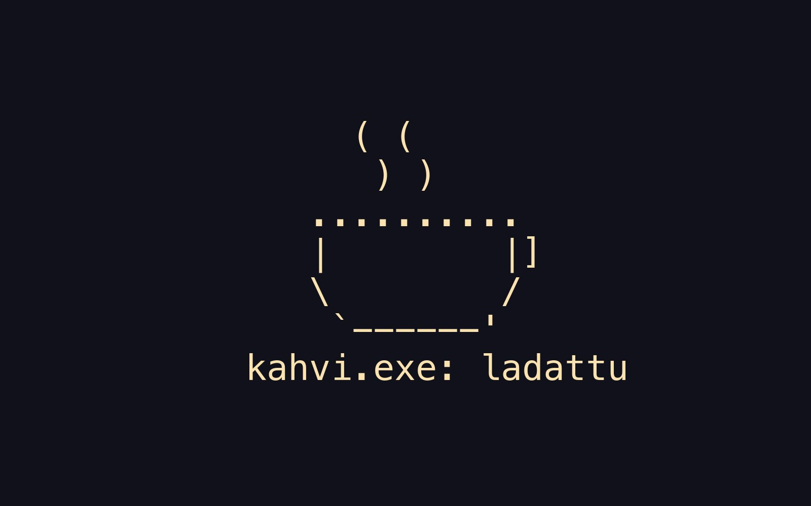
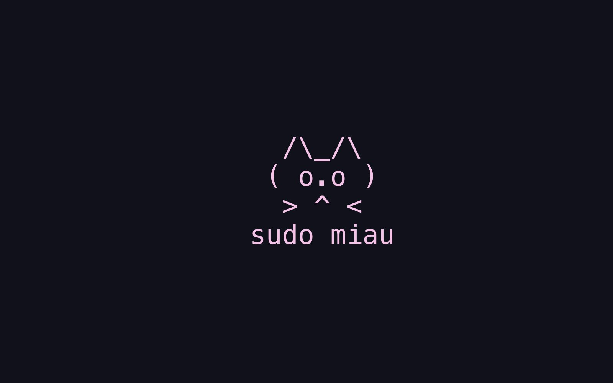
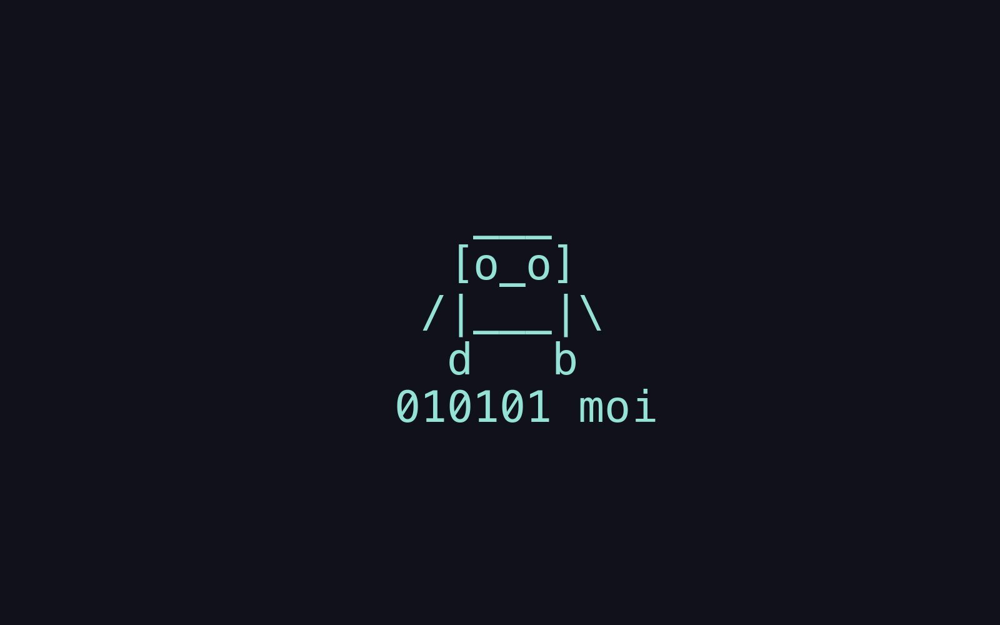
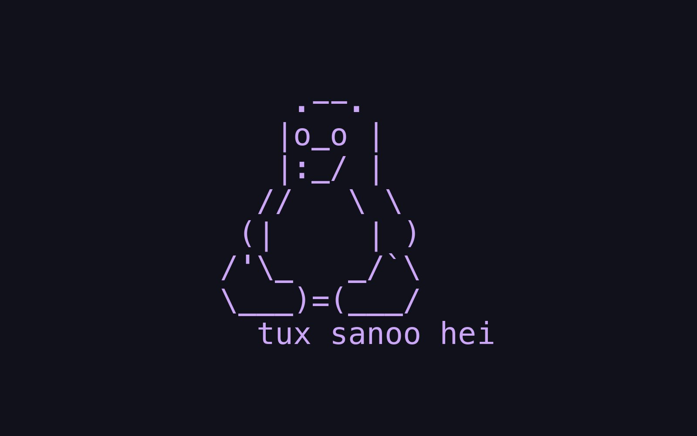

Löysit salaisen sivun! Tämä on esittely sivuston teemasta (nimeltä hugoccino, eli Hugo + Catppuccin), kaikista komponenteista ja siitä miten ne kirjoitetaan. Sivu ei ole valikossa eikä haussa, joten jos olet täällä, olet oikeaa porukkaa. ☕
{.lead}

Jokaisessa kohdassa on ensin Markdown ja sen alla lopputulos.

## Näppäimet ja nörttiominaisuudet

Sivustoa voi käyttää kokonaan näppäimistöllä:

| Näppäin | Mitä tapahtuu |
|---|---|
| <kbd class="kbd">/</kbd> tai <kbd class="kbd">Ctrl</kbd> <kbd class="kbd">K</kbd> | haku ja komennot |
| <kbd class="kbd">></kbd> haussa | komennot (esim. teeman vaihto) |
| <kbd class="kbd">#</kbd> haussa | hae avainsanoilla |
| <kbd class="kbd">t</kbd> | vaihda teema (vaalea / tumma) |
| <kbd class="kbd">g</kbd> + <kbd class="kbd">h</kbd> <kbd class="kbd">b</kbd> <kbd class="kbd">r</kbd> <kbd class="kbd">v</kbd> <kbd class="kbd">l</kbd> <kbd class="kbd">t</kbd> <kbd class="kbd">n</kbd> | siirry: etusivu, blogi, reseptit, vieraskirja, linkit, tietoa, nyt |
| <kbd class="kbd">p</kbd> / <kbd class="kbd">n</kbd> | edellinen / seuraava artikkeli |
| <kbd class="kbd">g</kbd> + <kbd class="kbd">s</kbd> | satunnainen artikkeli |
| <kbd class="kbd">?</kbd> | näppäinoikotiet |
| <kbd class="kbd">Esc</kbd> | sulje ikkuna |

Muuta pientä: jokaisella otsikolla on ankkuri (hiiren päällä näkyy linkki-ikoni), joten minkä tahansa kohdan voi linkittää muodossa `/hugoccino#teema`, koodilohkoissa on kopioi-nappi, artikkelin yläreunassa kulkee lukuetenemäpalkki, kuvia ja gallerioita voi selata lightboxissa nuolinäppäimillä, ja jos avaat selaimen kehittäjätyökalut, konsolissa odottaa tervehdys.

## Teema

Värit ovat [Catppuccinin](https://catppuccin.com/palette/) virallisia: vaalea teema on Latte ja tumma Mocha. Teema seuraa laitteen asetusta, ja <kbd class="kbd">t</kbd> vaihtaa sen käsin.

<div style="display:grid;grid-template-columns:repeat(auto-fill,minmax(6.5rem,1fr));gap:0.5rem;margin:1.5rem 0">
<div style="background:var(--ctp-rosewater);color:var(--ctp-crust);padding:0.75rem 0.5rem;border-radius:0.375rem;font:0.75rem var(--font-mono)">rosewater</div>
<div style="background:var(--ctp-flamingo);color:var(--ctp-crust);padding:0.75rem 0.5rem;border-radius:0.375rem;font:0.75rem var(--font-mono)">flamingo</div>
<div style="background:var(--ctp-pink);color:var(--ctp-crust);padding:0.75rem 0.5rem;border-radius:0.375rem;font:0.75rem var(--font-mono)">pink</div>
<div style="background:var(--ctp-mauve);color:var(--ctp-crust);padding:0.75rem 0.5rem;border-radius:0.375rem;font:0.75rem var(--font-mono)">mauve</div>
<div style="background:var(--ctp-red);color:var(--ctp-crust);padding:0.75rem 0.5rem;border-radius:0.375rem;font:0.75rem var(--font-mono)">red</div>
<div style="background:var(--ctp-maroon);color:var(--ctp-crust);padding:0.75rem 0.5rem;border-radius:0.375rem;font:0.75rem var(--font-mono)">maroon</div>
<div style="background:var(--ctp-peach);color:var(--ctp-crust);padding:0.75rem 0.5rem;border-radius:0.375rem;font:0.75rem var(--font-mono)">peach</div>
<div style="background:var(--ctp-yellow);color:var(--ctp-crust);padding:0.75rem 0.5rem;border-radius:0.375rem;font:0.75rem var(--font-mono)">yellow</div>
<div style="background:var(--ctp-green);color:var(--ctp-crust);padding:0.75rem 0.5rem;border-radius:0.375rem;font:0.75rem var(--font-mono)">green</div>
<div style="background:var(--ctp-teal);color:var(--ctp-crust);padding:0.75rem 0.5rem;border-radius:0.375rem;font:0.75rem var(--font-mono)">teal</div>
<div style="background:var(--ctp-sky);color:var(--ctp-crust);padding:0.75rem 0.5rem;border-radius:0.375rem;font:0.75rem var(--font-mono)">sky</div>
<div style="background:var(--ctp-sapphire);color:var(--ctp-crust);padding:0.75rem 0.5rem;border-radius:0.375rem;font:0.75rem var(--font-mono)">sapphire</div>
<div style="background:var(--ctp-blue);color:var(--ctp-crust);padding:0.75rem 0.5rem;border-radius:0.375rem;font:0.75rem var(--font-mono)">blue</div>
<div style="background:var(--ctp-lavender);color:var(--ctp-crust);padding:0.75rem 0.5rem;border-radius:0.375rem;font:0.75rem var(--font-mono)">lavender</div>
</div>

Leipäteksti on Atkinson Hyperlegible Next ja koodi sekä meta JetBrains Mono. Fontit ja skriptit tulevat samalta palvelimelta, ei ulkoisia fontti- tai skriptipalveluita.

## Teksti

````markdown
Tavallista tekstiä, **lihavointia**, *kursiivia*, ==merkittyä tekstiä==, ~~yliviivausta~~ ja [linkki](/blogi).
Alaviite[^1] ja `inline-koodi`.

[^1]: Alaviitteet näkyvät sivun lopussa.
````

Tavallista tekstiä, **lihavointia**, *kursiivia*, ==merkittyä tekstiä==, ~~yliviivausta~~ ja [linkki](/blogi). Alaviite[^1] ja `inline-koodi`.

Ingressi eli lead-teksti kirjoitetaan kappaleen perään lisäämällä `{.lead}` seuraavalle riville (tämän sivun ensimmäinen kappale on sellainen):

```markdown
Tämä on ingressi, joka erottuu leipätekstistä.
{.lead}
```

Listat, otsikot (`##`, `###`) ja taulukot ovat tavallista Markdownia:

````markdown
- Lista
  - Sisäkkäinen
1. Numeroitu

| Otsikko | Toinen |
|---|---|
| solu | solu |
````

## Koodi

Koodilohkoon kirjoitetaan kielen nimi, niin syntaksi väritetään. Hiiren päällä (tai kosketuslaitteella aina) näkyy kopioi-nappi.

````markdown
```php
Route::get('/blogi/{year}', function (int $year) {
    // ...
});
```
````

```php
<?php

use App\Models\Post;
use Illuminate\Support\Facades\Route;

Route::get('/blogi/{year}', function (int $year) {
    $posts = Post::query()
        ->whereYear('published_at', $year)
        ->latest('published_at')
        ->get();

    return view('blogi.index', [
        'year' => $year,
        'posts' => $posts,
    ]);
})->whereNumber('year');
```

```toml
[params]
  description = "Hugo, Tailwind ja Catppuccin"
```

Rivinumerot eivät ole oletuksena, mutta ne saa lohkoon lisäämällä kielen perään `{linenos=true}`:

````markdown
```bash {linenos=true}
cd ~/Sites/blogi
git pull
```
````

```bash {linenos=true}
cd ~/Sites/blogi
git pull
```

Kielitunnisteita on kymmeniä (`php`, `bash`, `toml`, `yaml`, `js` ja niin edelleen). Ilman kieltä lohko on pelkkää tekstiä, ja sekin voidaan kopioida:

```
sudo apt-get install hugo
```

## Huomiolaatikot

Ne kirjoitetaan lainauksena, jonka alussa on merkintä. Tyypit ovat `NOTE`, `TIP`, `IMPORTANT`, `WARNING` ja `CAUTION`, ja oman otsikon voi lisätä merkinnän perään.

````markdown
> [!TIP] Oma otsikko
> Teksti, jossa voi olla **lihavointia**, [linkki](/blogi) ja `koodia`.
````

> [!NOTE]
> Huomio: tavallinen tieto.

> [!TIP] Oma otsikko
> Vinkki, jossa on **lihavointia**, [linkki](/blogi) ja `koodia`.

> [!IMPORTANT]
> Tärkeä asia.

> [!WARNING]
> Varoitus.

> [!CAUTION]
> Varo tätä.

## Lainaus

Lainaus on tavallinen Markdown-lainaus. Jos viimeinen kappale alkaa ajatusviivalla, siitä tulee lähde.

````markdown
> Hyvä koodi on kuin hyvä vitsi: jos se pitää selittää, se ei ole kovin hyvä.
>
> — Joku viisas
````

> Hyvä koodi on kuin hyvä vitsi: jos se pitää selittää, se ei ole kovin hyvä.
>
> — Joku viisas

## Koodikommentti

Huomautus, joka näyttää koodin kommentilta. Jokainen kappale saa `//`-merkin eteensä.

````markdown

TODO: tämä osio pitää kirjoittaa uudestaan.

Huom: asetus toimii vain Hugo 0.169:ssä tai uudemmassa.

````


TODO: tämä osio pitää kirjoittaa uudestaan.

Huom: asetus toimii vain Hugo 0.169:ssä tai uudemmassa.


## Kuvat

Kuvat laitetaan artikkelin kansioon ja linkitetään pelkällä tiedostonimellä. Hugo tekee niistä sopivan kokoiset webp-kuvat, ja kuvaa klikkaamalla se aukeaa lightboxiin. Tiedostonimen perään lainausmerkeissä oleva teksti on kuvateksti.

```markdown

```

")

### Galleria

Useampi kuva `galleria`-shortcodella. Lightboxissa kuvien välillä liikutaan nuolinäppäimillä.

````markdown




````








## Painikkeet

Latauslinkki, jossa on ikoni:

````markdown

````



## Upotukset

YouTube ja Vimeo kirjoitetaan Hugon omilla shortcodeilla, ja ne käyttävät yksityisyysystävällisiä osoitteita (youtube-nocookie ja Do Not Track). Spotify liitetään tavallisella iframella. Nämä lataavat ulkoisen palvelun, joten ne on tässä vain koodina.

````markdown



<iframe src="https://open.spotify.com/embed/track/RAIDAN_ID" title="Spotify" loading="lazy" allowfullscreen></iframe>
````

## Terminaalityyli

Artikkelin tiedoissa sanamäärä on `wc`-tyylinen (vie hiiri päälle: `$ wc -w index.md`), ja alaosan lähderivi on `git blame` -tyylinen:

```text
$ wc -w index.md
1 204 index.md
$ git blame content/2020/esimerkki/index.md
→ Marko Kaartinen, 2020-01-02 · ehdota korjausta
```

Lisäksi `p` ja `n` siirtyvät edelliseen ja seuraavaan artikkeliin, alaviitteet avautuvat pieneen ikkunaan, artikkelin lukuetenemä näkyy alakulmassa muodossa `[#####-----] 52 %`, yli kaksi vuotta vanhoissa artikkeleissa on varoitus ja komentopaletin `shuf` arpoo satunnaisen artikkelin (oikotie `g` + `s`).

## Tehtävälistat

Tavallinen Markdownin tehtävälista näkyy `[x]`- ja `[ ]`-merkkeinä. Tehty rivi on yliviivattu ja vihreällä, ja epäonnistunut tehtävä kirjoitetaan yliviivattuna (`~~teksti~~`), jolloin se saa punaisen `[!]`-merkin:

````markdown
- [x] tehty
- [ ] tekemättä
- [ ] ~~peruttu tai epäonnistui~~
````

- [x] tehty
- [ ] tekemättä
- [ ] ~~peruttu tai epäonnistui~~

## Komentotyyliset otsikot

Sivulle voi laittaa otsikoihin `$`-kehotteen lisäämällä front matteriin `komennot: true`. Otsikko kirjoitetaan komentona, esimerkiksi `## ls ~/koti 🏡 {#koti}` (loppuun oma ankkuri, jotta osoite on lyhyt). Esimerkki on [Nyt](/nyt)-sivulla.

## Sivun löytäminen

Jos osoite ei löydy, 404-sivu näyttää haetun osoitteen komentona (`cd /osoite`), ehdottaa samankaltaisia artikkeleita osoitteen sanojen perusteella ja tarjoaa `shuf`-napin sekä valmiiksi täytetyn haun. Kokeile avata jokin olematon osoite, esimerkiksi `/2012/nokia-n97-vaara`.

## Uusi sisältö

Pohjat ovat kansiossa `archetypes/`: `./uusi artikkeli` (myös `resepti` ja `sivu`, otsikko kysytään). Komennot on kuvattu tarkemmin repon README:ssä.

## Resepti

Reseptillä on oma sivutyyppinsä, jossa ainesosien määrä skaalautuu annosmäärän mukaan. Kokeile esimerkiksi [Tsatsikia](/resepti/tsatsiki).

## Lähdekoodi

Koko sivusto ja tämä teema ovat avointa lähdekoodia: [MarkoKaartinen/MarkoKaartinen.net](https://github.com/MarkoKaartinen/MarkoKaartinen.net). Tehty [Hugolla](https://gohugo.io), [Tailwindilla](https://tailwindcss.com), Catppuccin-väreillä, [Lucide](https://lucide.dev)- ja [Simple Icons](https://simpleicons.org) -ikoneilla sekä JetBrains Mono- ja Atkinson Hyperlegible Next -fonteilla.

[^1]: Alaviitteet näkyvät sivun lopussa.
